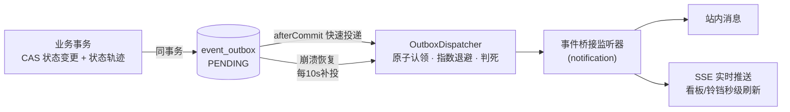

<div align="center">

# 🏭 巡维云 EquipCare

**新一代开源设备巡检维保平台 · Event-Driven CMMS**

[](LICENSE)
[](https://adoptium.net/)
[](https://spring.io/projects/spring-boot)
[](../../actions/workflows/ci.yml)
[](CONTRIBUTING.md)
[](../../stargazers)

**English** | [English below](#-english)

</div>

---

> 一套开箱即用的**工业设备巡检维保（CMMS/EAM）平台**：从设备台账、二维码扫码巡检、
> 异常自动转工单，到七态状态机驱动的维修闭环、SLA 超时升级、备件出入库与成本核算，
> 再到设备健康分与 AI 故障诊断——**完整覆盖设备全生命周期**。
>
> 不只是又一个管理系统：**事件驱动架构（事务性 Outbox）+ SSE 实时推送 + 可插拔 AI 副驾**，
> 每一行架构都有可执行的守护测试。
>
> 🧩 **它同时是一套设备域业务框架**：模块化分层、事件总线、权限模型、审计/通知/实时推送
> 等横切设施全部就位——空库启动、零演示数据，新业务模块按
> [框架扩展指南](docs/14-框架扩展指南.md) 七步接入，依赖方向由 ArchUnit 在 CI 中强制。

## 🏗️ 架构

**模块化单体，依赖严格分层（ArchUnit 强制）**：

```
                    ┌─────────────────┐
                    │ equipcare-admin │ 启动打包 · 静态前端 · 集成测试
                    └───────┬─────────┘
          ┌─────────────────┼──────────────────┐
  ┌───────▼───────┐ ┌───────▼───────┐  ┌───────▼───────┐
  │ equipcare-ai  │ │equipcare-business│  业务模块：asset/workorder/
  │ AI 副驾(可插拔)│ │ │ inspection/inventory/analytics/export/notification
  └───────┬───────┘ └───────┬───────┘  └───────────────┘
          │         ┌───────▼───────┐
          │         │equipcare-system│ 系统管理：用户/角色/部门/文件
          │         └───────┬───────┘
  ┌───────▼─────────────────▼───────┐
  │        equipcare-framework      │ 框架核心：JWT 安全链 / 基础设施配置 / 审计切面 / Outbox
  └───────────────┬─────────────────┘
          ┌───────▼────────┐
          │ equipcare-common│ 统一响应/异常/登录上下文/SSE Hub/领域事件接口
          └────────────────┘
```

**事件驱动改造后的写路径**（以工单流转为例）：



- 业务回滚 ⇒ 事件消失；业务提交 ⇒ 事件**至少一次**必达；
- 消费方幂等（SLA 当日去重 / 库存消息表计数），与升级前行为完全一致；
- 为什么不用 Spring Modulith？见 [技术决策记录](docs/12-创新升级说明.md)。

**技术栈**：Spring Boot 3.5 · MyBatis-Plus · MySQL 8 · Redis · JWT (jjwt) ·
ZXing · Apache POI · ECharts · 原生 ES Module 前端（零框架依赖）· JDK HttpClient AI 客户端（零新依赖）

## 🚀 快速开始

### 方式一：Docker Compose 一键起（推荐）

```bash
git clone https://github.com/Leterhong/EquipCare.git
cd EquipCare/equipcare-server
cp deploy/env.example .env          # 修改其中的密码与 JWT 密钥
docker compose up -d                # mysql + redis + backend + nginx 前端
```

创建管理员（仅首次）：

```bash
docker compose exec backend java -jar /app/app.jar \
  --equipcare.bootstrap.enabled=true \
  --equipcare.bootstrap.username=admin \
  --equipcare.bootstrap.password='你的强口令' \
  --equipcare.bootstrap.real-name=系统管理员
```

打开 `http://localhost` → 登录 → 开始使用。

### 方式二：本地开发

```bash
# 前置：JDK 17+ / MySQL 8 / Redis，执行 database/schema.sql + seed.sql
mysql -u root -p equipcare < database/schema.sql
mysql -u root -p equipcare < database/seed.sql      # 系统基础数据（无账号）

mvn spring-boot:run -pl equipcare-admin             # dev profile，改前端刷新即生效
```

### 🤖 点亮 AI 副驾（可选）

```bash
# .env 或环境变量——OpenAI 兼容协议，任选一家
EQUIPCARE_AI_ENABLED=true
EQUIPCARE_AI_BASE_URL=https://ark.cn-beijing.volces.com/api/v3   # 火山方舟豆包
# EQUIPCARE_AI_BASE_URL=https://open.bigmodel.cn/api/paas/v4     # 智谱 GLM
# EQUIPCARE_AI_BASE_URL=https://api.deepseek.com/v1              # DeepSeek
EQUIPCARE_AI_API_KEY=你的Key
EQUIPCARE_AI_MODEL=doubao-seed-1-6-251015
```

重启后在任意工单详情页看到「AI 智能副驾」：⚡故障诊断（流式）/ ⚡AI 推荐维修人 / 📄 生成维修报告。
**不配置则 AI 入口自动隐藏，系统所有功能不受影响。**

## 📄 License

[MIT](LICENSE) © 2026 Leterhong

---

<div align="center">

<a id="-english"></a>

## 🌍 English

**EquipCare** is an open-source, event-driven CMMS/EAM (Computerized Maintenance
Management System) platform for industrial equipment: QR-code inspections, a
seven-state work-order state machine with CAS concurrency control, SLA escalation,
spare-parts inventory, explainable equipment health scoring, and a pluggable AI
copilot (streaming fault diagnosis / smart dispatch / repair reports) over any
OpenAI-compatible provider.

**Architecture highlights**: modular monolith (Maven multi-module) enforced by
ArchUnit tests · transactional outbox for reliable domain events · SSE push with
one-time ticket auth · zero-dependency AI client · native ES-module frontend with
dark mode & PWA — 199 automated tests and CI included.

```bash
git clone https://github.com/Leterhong/EquipCare.git && cd EquipCare/equipcare-server
cp deploy/env.example .env && docker compose up -d   # done
```

Full documentation is in Chinese; English docs are on the roadmap. PRs welcome!

</div>
