<div align="center">

# 🏭 巡维云 EquipCare

**新一代开源设备巡检维保平台 · Event-Driven CMMS**

*扫码巡检 · 七态工单状态机 · SLA 预警 · 事务性 Outbox · SSE 实时推送 · AI 维修副驾*

[](LICENSE)
[](https://leterhong.github.io/EquipCare/)
[](https://adoptium.net/)
[](https://spring.io/projects/spring-boot)
[](../../actions/workflows/ci.yml)
[](CONTRIBUTING.md)
[](../../stargazers)

**English** | [English below](#-english)

</div>

---

> 一套开箱即用的**工业设备巡检维保（CMMS/EAM）平台**：从设备台账、二维码扫码巡检、
> 异常自动转工单，到七态状态机驱动的维修闭环、SLA 超时升级、备件出入库与成本核算，
> 再到设备健康分与 AI 故障诊断——**完整覆盖设备全生命周期**。
>
> 不只是又一个管理系统：**事件驱动架构（事务性 Outbox）+ SSE 实时推送 + 可插拔 AI 副驾**，
> 每一行架构都有可执行的守护测试。
>
> 🌐 **在线介绍页（含界面画廊 / 架构图解 / AI 演示动画）**：
> **[leterhong.github.io/EquipCare](https://leterhong.github.io/EquipCare/)**

## ✨ 核心特性

| 领域 | 能力 |
|---|---|
| 📟 **设备台账** | 一物一码（服务端 ZXing 二维码）、分类/位置树、生命周期状态机、附件与照片留证 |
| 🔍 **扫码巡检** | 模板 → 计划 → 定时任务生成（含停机回补）→ 手机扫码执行 → 异常自动转工单；巡检日历与统计 |
| 🎫 **维修工单** | 七态状态机 × CAS 乐观锁（并发冲突 409）、动作白名单按钮、派单/拒接/转派/强制转派、维修前后留证、验收与评价 |
| ⏰ **SLA 预警** | 按等级动态计算响应/修复时限，WARN→OVERDUE 分级推进，当日去重的升级通知 |
| 📦 **备件库存** | 出入库流水（只插入表）、工单领用与退料、安全库存预警、备件成本进工单 |
| 💚 **健康分** | 规则可解释的设备健康评分（工单/超时/异常/逾期多维扣分 + 奖励项），每日快照与趋势 |
| ⚡ **事件驱动** | 领域事件经**事务性 Outbox**（`event_outbox`）可靠投递：与业务同事务提交、崩溃自动补投、指数退避、判死告警——架构方向由 ArchUnit 测试守护 |
| 📡 **实时推送** | SSE 通道（30 秒一次性票据鉴权）：新消息、工单流转、SLA/库存/巡检异常**秒级直达**，断线自动退避重连并回退轮询 |
| 🤖 **AI 副驾** | 故障诊断（流式 Markdown：根因/步骤/备件/安全事项）、智能派单 TOP3（算法预打分 + LLM 理由）、维修报告一键生成；OpenAI 兼容协议可接豆包/智谱/DeepSeek，**默认关闭、fail-open** |
| 🌙 **现代前端** | 原生 ES Module 零构建依赖、28 个业务页面、暗色模式、PWA 离线外壳、摄像头扫码（BarcodeDetector） |

## 📸 界面预览

| 运维驾驶舱 | 设备台账 |
|---|---|
| 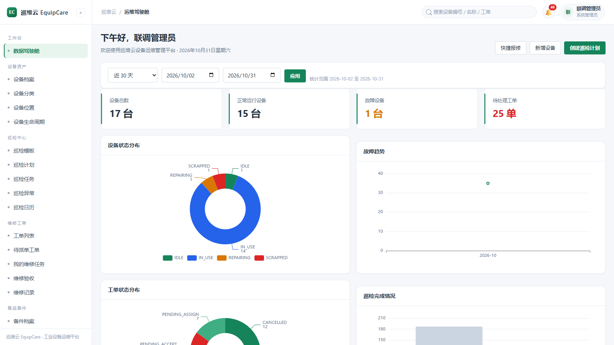 | 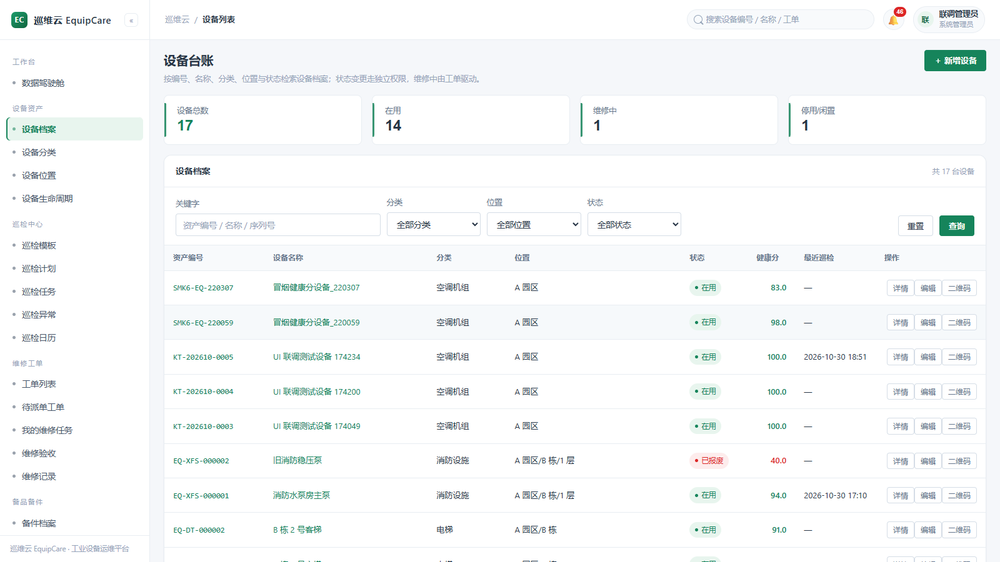 |
| **工单看板（七态 × SLA 倒计时）** | **巡检日历** |
| 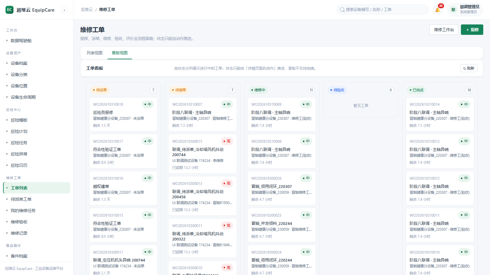 | 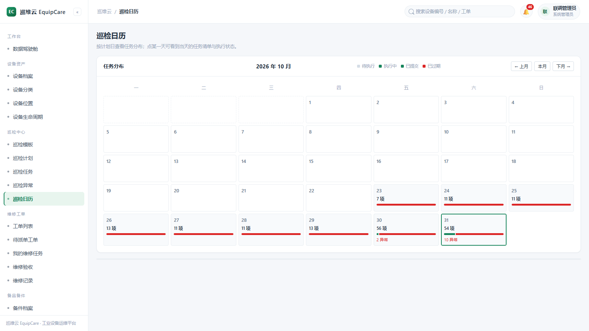 |
| **工单详情（全生命周期）** | **移动端扫码档案** |
| 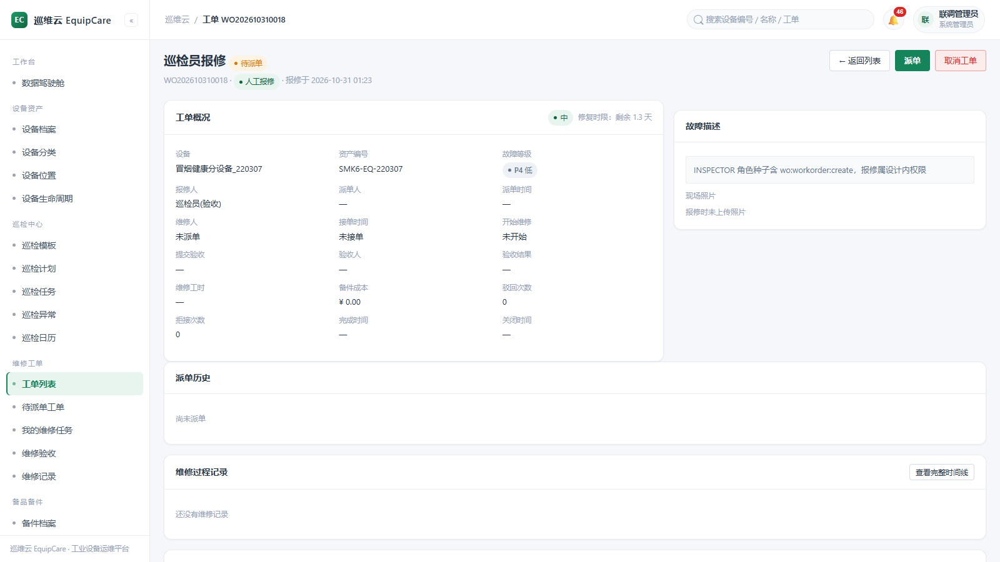 | 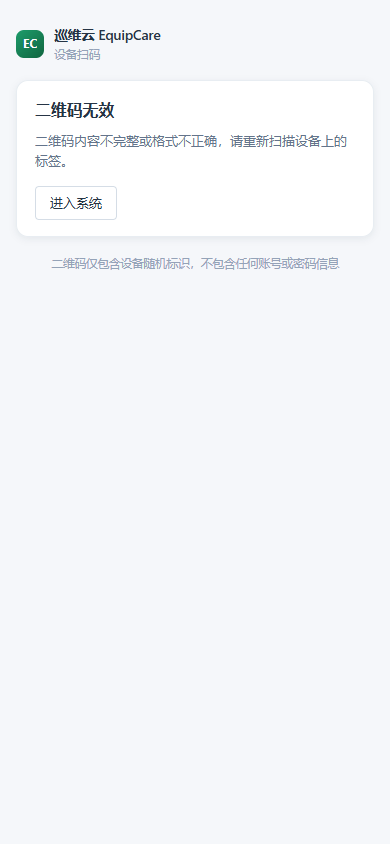 |

<details>
<summary><b>更多截图（144 张全量 UI 存档）</b></summary>

| | |
|---|---|
| 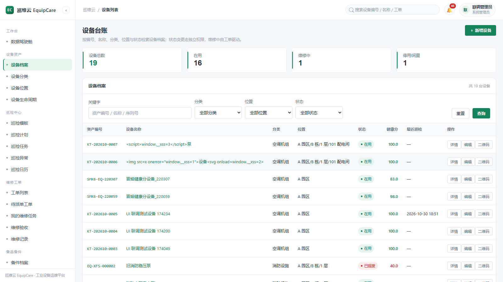 | 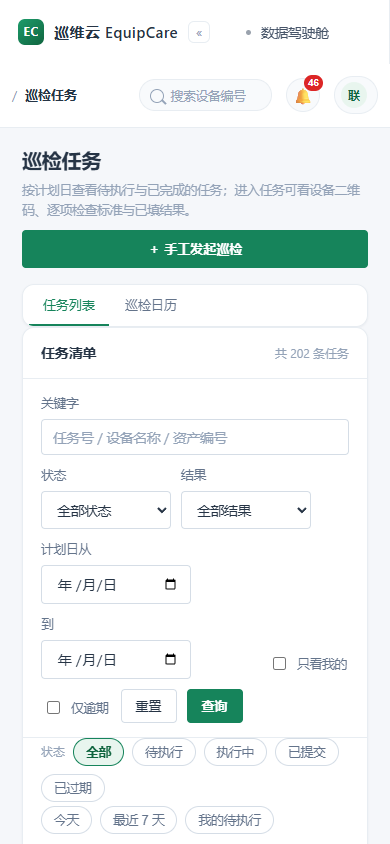 |
| 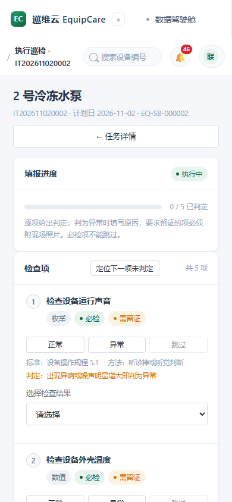 | 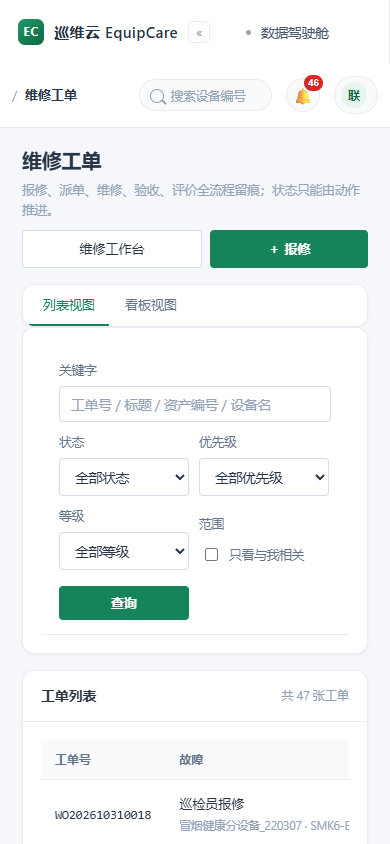 |

完整存档见 [`equipcare-server/docs/screenshots/`](equipcare-server/docs/screenshots/)。
</details>

## 🏗️ 架构

**模块化单体，依赖严格分层（ArchUnit 强制）**：

```
                    ┌─────────────────┐
                    │ equipcare-admin │ 启动打包 · 静态前端 · 集成测试
                    └───────┬─────────┘
          ┌─────────────────┼──────────────────┐
  ┌───────▼───────┐ ┌───────▼───────┐  ┌───────▼───────┐
  │ equipcare-ai  │ │equipcare-business│  业务模块：asset/workorder/
  │ AI 副驾(可插拔)│ │ │ inspection/inventory/analytics/export/notification
  └───────┬───────┘ └───────┬───────┘  └───────────────┘
          │         ┌───────▼───────┐
          │         │equipcare-system│ 系统管理：用户/角色/部门/文件
          │         └───────┬───────┘
  ┌───────▼─────────────────▼───────┐
  │        equipcare-framework      │ 框架核心：JWT 安全链 / 基础设施配置 / 审计切面 / Outbox
  └───────────────┬─────────────────┘
          ┌───────▼────────┐
          │ equipcare-common│ 统一响应/异常/登录上下文/SSE Hub/领域事件接口
          └────────────────┘
```

**事件驱动改造后的写路径**（以工单流转为例）：

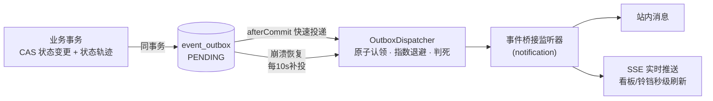

- 业务回滚 ⇒ 事件消失；业务提交 ⇒ 事件**至少一次**必达；
- 消费方幂等（SLA 当日去重 / 库存消息表计数），与升级前行为完全一致；
- 为什么不用 Spring Modulith？见 [技术决策记录](docs/12-创新升级说明.md)。

**技术栈**：Spring Boot 3.5 · MyBatis-Plus · MySQL 8 · Redis · JWT (jjwt) ·
ZXing · Apache POI · ECharts · 原生 ES Module 前端（零框架依赖）· JDK HttpClient AI 客户端（零新依赖）

## 🚀 快速开始

### 方式一：Docker Compose 一键起（推荐）

```bash
git clone https://github.com/Leterhong/EquipCare.git
cd EquipCare/equipcare-server
cp deploy/env.example .env          # 修改其中的密码与 JWT 密钥
docker compose up -d                # mysql + redis + backend + nginx 前端
```

创建管理员（仅首次）：

```bash
docker compose exec backend java -jar /app/app.jar \
  --equipcare.bootstrap.enabled=true \
  --equipcare.bootstrap.username=admin \
  --equipcare.bootstrap.password='你的强口令' \
  --equipcare.bootstrap.real-name=系统管理员
```

打开 `http://localhost` → 登录 → 开始使用。

### 方式二：本地开发

```bash
# 前置：JDK 17+ / MySQL 8 / Redis，执行 database/schema.sql + seed.sql
mysql -u root -p equipcare < database/schema.sql
mysql -u root -p equipcare < database/seed.sql      # 演示基础数据（无账号）

mvn spring-boot:run -pl equipcare-admin             # dev profile，改前端刷新即生效
```

### 🤖 点亮 AI 副驾（可选）

```bash
# .env 或环境变量——OpenAI 兼容协议，任选一家
EQUIPCARE_AI_ENABLED=true
EQUIPCARE_AI_BASE_URL=https://ark.cn-beijing.volces.com/api/v3   # 火山方舟豆包
# EQUIPCARE_AI_BASE_URL=https://open.bigmodel.cn/api/paas/v4     # 智谱 GLM
# EQUIPCARE_AI_BASE_URL=https://api.deepseek.com/v1              # DeepSeek
EQUIPCARE_AI_API_KEY=你的Key
EQUIPCARE_AI_MODEL=doubao-seed-1-6-251015
```

重启后在任意工单详情页看到「AI 智能副驾」：⚡故障诊断（流式）/ ⚡AI 推荐维修人 / 📄 生成维修报告。
**不配置则 AI 入口自动隐藏，系统所有功能不受影响。**

## 🧪 质量保障

| 测试 | 数量 | 覆盖 |
|---|---|---|
| 后端单元测试 | **134** | 状态机、健康分算法、JWT、Outbox 退避策略、AI 提示词、**架构守护（ArchUnit）** |
| 前端 Vitest | **65** | 请求封装、鉴权、巡检执行、备件入库、工单状态、AI Markdown 渲染 |
| 黑盒冒烟脚本 | 8 套 | 巡检→异常→工单→验收全闭环（`scripts/`，200+ 断言） |
| 集成测试 | 9 个 IT | 全上下文启动（`mvn verify`，需 MySQL+Redis） |

```bash
mvn test                            # 后端全部测试（含架构守护）
cd frontend-tests && npx vitest run # 前端测试
```

## 📂 仓库结构

```
EquipCare/
├── docs/                        # 产品需求/架构设计/数据库/部署/测试报告/创新升级说明（12 份）
├── equipcare-server/            # 全部代码（Maven 多模块，见其 README 获取深度开发文档）
│   ├── equipcare-{common,system,framework,business,ai,admin}/
│   ├── database/                # schema.sql(37表) / seed.sql / 幂等增量脚本
│   ├── deploy/                  # nginx.conf / docker-init / env.example / backup.sh
│   ├── scripts/                 # 黑盒冒烟与 UI 验证脚本（Python）
│   └── frontend-tests/          # Vitest 前端测试
└── .github/workflows/ci.yml     # 后端构建+测试 / 前端 Vitest 双流水线
```

## 🗺️ 路线图

- [x] 设备台账 / 扫码巡检 / 七态工单 / SLA / 备件 / 健康分
- [x] 事件驱动（事务性 Outbox）+ SSE 实时推送
- [x] AI 副驾：诊断 / 智能派单 / 维修报告
- [ ] **Vue 3 + Vite + TS 前端重构**（新旧共存分批迁移）
- [ ] AI 深化：巡检拍照缺陷识别（多模态）、维修知识库 RAG
- [ ] 通知外发：企业微信 / 邮件（事件监听器已就位，即插即用）
- [ ] 预测性维护：MTBF/MTTR 趋势预警
- [ ] 多租户 SaaS 化

> 想参与？从 [CONTRIBUTING.md](CONTRIBUTING.md) 开始，路线图上的每一项都欢迎认领。

## 🙌 谁在用 / 适合谁

适合：工厂设备科、物业设施管理、实验室/医院后勤、连锁门店维保外包管理，
以及需要一个**架构干净的 Spring Boot 模块化单体参考实现**的团队与学习者。

## 📄 License

[MIT](LICENSE) © 2026 Leterhong

---

<div align="center">

<a id="-english"></a>

## 🌍 English

**EquipCare** is an open-source, event-driven CMMS/EAM (Computerized Maintenance
Management System) platform for industrial equipment: QR-code inspections, a
seven-state work-order state machine with CAS concurrency control, SLA escalation,
spare-parts inventory, explainable equipment health scoring, and a pluggable AI
copilot (streaming fault diagnosis / smart dispatch / repair reports) over any
OpenAI-compatible provider.

**Architecture highlights**: modular monolith (Maven multi-module) enforced by
ArchUnit tests · transactional outbox for reliable domain events · SSE push with
one-time ticket auth · zero-dependency AI client · native ES-module frontend with
dark mode & PWA — 199 automated tests and CI included.

```bash
git clone https://github.com/Leterhong/EquipCare.git && cd EquipCare/equipcare-server
cp deploy/env.example .env && docker compose up -d   # done
```

Full documentation is in Chinese; English docs are on the roadmap. PRs welcome!

</div>
