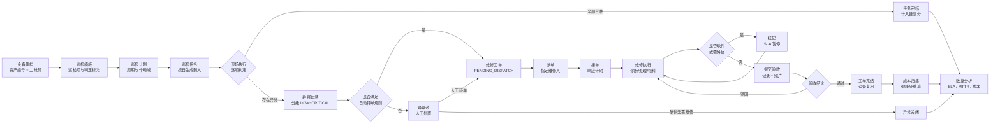
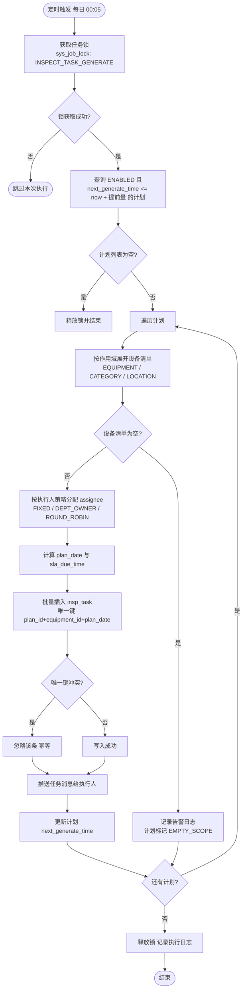
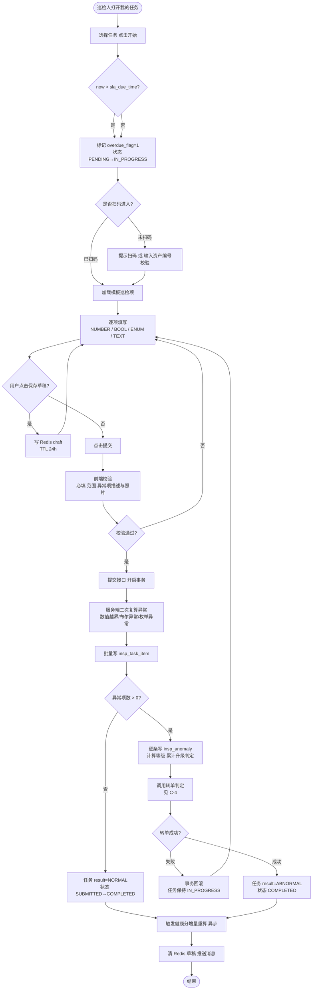
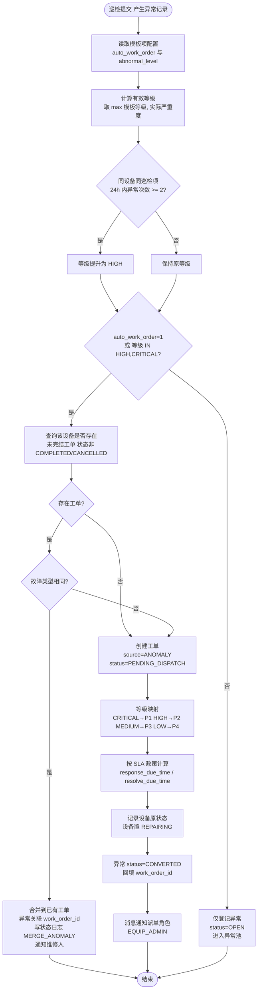
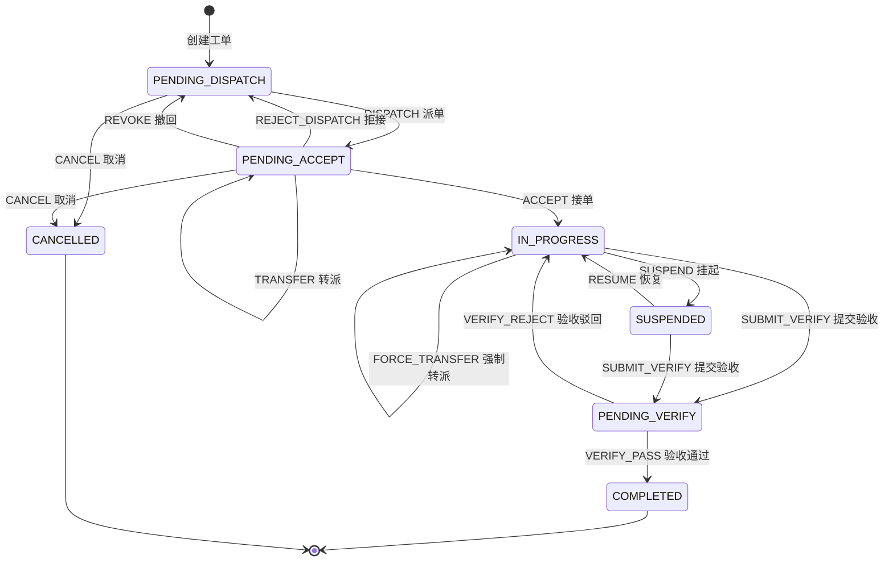
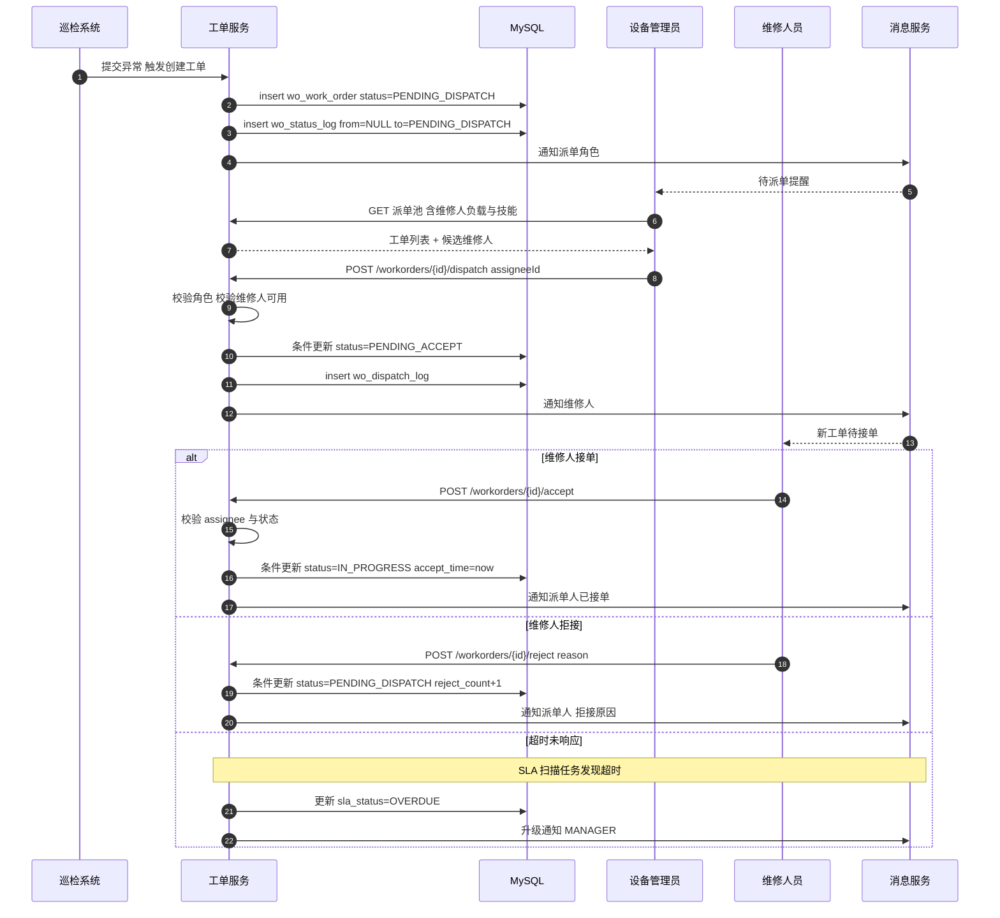
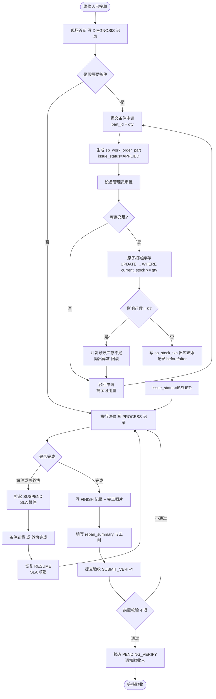
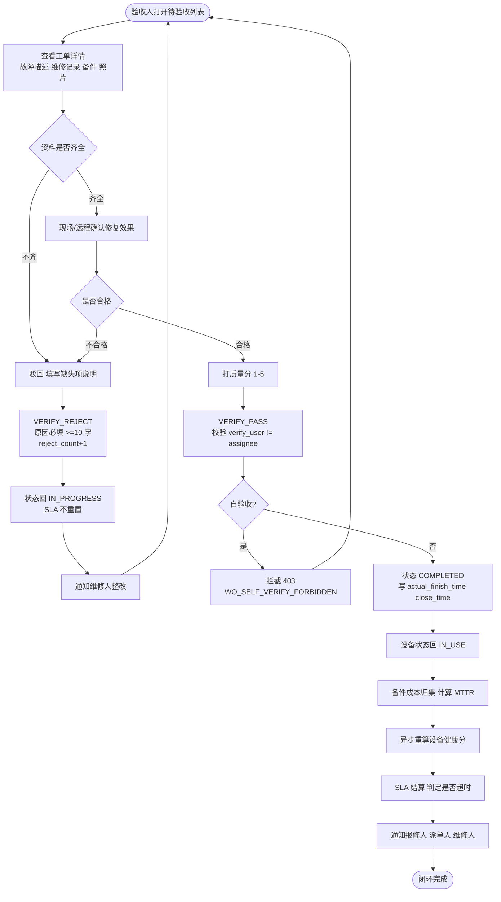
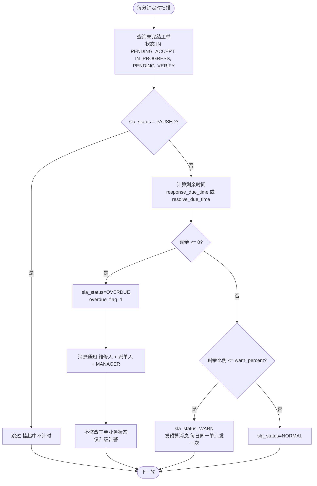

# 巡维云 EquipCare 业务流程与工单状态机

| 项 | 内容 |
|---|---|
| 文档编号 | EC-FLOW-002 |
| 版本 | V1.0 |
| 对应任务 | **C（完整业务流程图）** |

> 本文件中的全部流程图采用 Mermaid 语法，可直接在支持 Mermaid 的 Markdown 渲染器（Typora / VS Code / GitLab / 语雀）中查看。若渲染器不支持，可按节点文字阅读，图与文一一对应。

---

## 1. 总体业务闭环（C-1）

系统的主干是一条单向可追溯的链路，每一环都有独立单据与时间戳，任意环节可反查上下游。

**闭环的三个硬性约束**

1. 异常必须落地：巡检提交时若判定异常，`insp_anomaly` 必然产生一条记录，不存在"只改设备状态不留痕"的路径。
2. 工单必有来源：工单 `source` 字段只允许 `INSPECT`（巡检）、`ANOMALY`（手工转单）、`MANUAL`（扫码报修）、`PLAN_MAINTAIN`（保养计划），不允许来源为空。
3. 完结必有验收：工单不可由维修人直接置为完成，必须经 `PENDING_VERIFY`，且验收人 ≠ 维修人。

---

## 2. 巡检计划到任务生成（C-2）

定时任务每日 00:05 执行，采用"数据库锁表 + 幂等唯一键"双保险，防止重复生成。

**关键设计说明**

| 设计点 | 原因 |
|---|---|
| 作用域快照展开 | 计划启用时把设备清单落到 `insp_plan_equipment` 快照表，新增设备不会被静默纳入，避免任务量突增导致执行人崩溃 |
| 唯一键防重 | 即使定时任务被重复触发、或手工"立即生成"与定时冲突，也不会产生重复任务 |
| 提前生成 | `generate_ahead_hours` 默认 24h，保证执行人早上打开系统即能看到当天任务 |
| 锁表而非分布式锁 | 单实例部署，用 `sys_job_lock` 一行记录 + `lock_until` 即可，不引入额外中间件 |

---

## 3. 巡检执行与异常上报（C-3）

**为什么"二次复算异常"必须放在服务端**

前端可被篡改（浏览器控制台、重放请求）。若只信任前端 `is_abnormal` 标记，巡检人员漏勾选即可让不合格设备"合格"，系统失去监督价值。服务端依据模板配置重新判定，是这条链路可信的基础。

---

## 4. 异常自动转维修工单判定（C-4，核心）

**判定规则的边界情况（必须写进单元测试）**

| 场景 | 期望行为 |
|---|---|
| 同一张任务里 3 个巡检项都异常 | 生成 3 条异常；若故障类型相同则只生成 1 张工单，其余 2 条异常合并挂靠 |
| 设备已有 `IN_PROGRESS` 工单，新巡检又报同类异常 | 不新建，合并到在途工单并通知维修人 |
| 设备已有 `PENDING_VERIFY` 工单，新报不同类异常 | 新建工单（不同故障应独立跟踪），两张工单并存，设备状态保持 `REPAIRING` |
| 异常等级 LOW 且 `auto_work_order=0` | 只登记，进入异常池，可由管理员手工转单 |
| 转单过程中设备已被报废 | 工单创建失败，事务回滚，异常保留 `OPEN`，提示"设备已报废，请先恢复设备状态" |
| 重复提交同一任务（网络重试） | 因 `wo_work_order.anomaly_id` 唯一索引，第二次插入失败并捕获，返回已有工单号 |

---

## 5. 工单状态机（C-5，强制约束）

### 5.1 状态定义

| 状态码 | 中文 | 语义 | 是否终态 |
|---|---|---|---|
| `PENDING_DISPATCH` | 待派单 | 工单已创建，等待设备管理员指派维修人 | 否 |
| `PENDING_ACCEPT` | 待接单 | 已派单，等待维修人确认接单 | 否 |
| `IN_PROGRESS` | 维修中 | 维修人已接单，正在处理 | 否 |
| `SUSPENDED` | 已挂起 | 缺备件/等外协，计时冻结 | 否 |
| `PENDING_VERIFY` | 待验收 | 维修人提交完工，等待验收 | 否 |
| `COMPLETED` | 已完成 | 验收通过，工单闭环 | 是 |
| `CANCELLED` | 已取消 | 误报或无需维修，管理员取消 | 是 |

> 说明：`SUSPENDED` 是本设计特意保留的状态，而非用 `IN_PROGRESS` + 标记位表达。原因是它影响 SLA 计时这一核心考核逻辑，必须是一个可被状态机校验、可被报表单独统计的显式状态。

### 5.2 状态流转图

### 5.3 状态转移表（唯一事实来源，代码按此表实现）

| # | 动作 | from → to | 允许角色 | 前置守卫条件 | 事务内副作用 |
|---|---|---|---|---|---|
| 1 | `DISPATCH` | `PENDING_DISPATCH → PENDING_ACCEPT` | EQUIP_ADMIN / ADMIN | 目标维修人存在且 `status=1`；工单未被取消 | 写 `assignee_id`、`dispatch_time`、`dispatcher_id`；写 `wo_dispatch_log`；更新 `response_due_time`；通知维修人 |
| 2 | `ACCEPT` | `PENDING_ACCEPT → IN_PROGRESS` | 当前 `assignee_id` 本人 | `assignee_id = 当前用户`；未超 `response_due_time` 则记按时响应 | 写 `accept_time`、`start_repair_time`；若已超时置 `overdue_flag=1`；通知派单人 |
| 3 | `REJECT_DISPATCH` | `PENDING_ACCEPT → PENDING_DISPATCH` | 当前 `assignee_id` 本人 | 拒接原因 ≥ 5 字 | `reject_count+1`；清空 `assignee_id`；写派单日志 `reject_flag=1`；`reject_count≥3` 升级通知 MANAGER |
| 4 | `TRANSFER` | `PENDING_ACCEPT → PENDING_ACCEPT` | EQUIP_ADMIN / ADMIN | 新维修人 ≠ 原维修人 | 写 `wo_dispatch_log`（`TRANSFER`）；重置 `response_due_time`；通知新旧两人 |
| 5 | `REVOKE` | `PENDING_ACCEPT → PENDING_DISPATCH` | EQUIP_ADMIN / ADMIN | 维修人尚未接单（`accept_time IS NULL`） | 清空 `assignee_id`；写派单日志 |
| 6 | `SUSPEND` | `IN_PROGRESS → SUSPENDED` | 当前 `assignee_id` 本人 | 挂起原因 ≥ 5 字 | 写 `suspend_start_time`；`sla_status=PAUSED`；通知派单人 |
| 7 | `RESUME` | `SUSPENDED → IN_PROGRESS` | 当前 `assignee_id` 本人 | — | 累计 `suspend_total_minutes`；`resolve_due_time += 挂起时长`；`sla_status` 恢复为 `NORMAL` |
| 8 | `SUBMIT_VERIFY` | `IN_PROGRESS / SUSPENDED → PENDING_VERIFY` | 当前 `assignee_id` 本人 | ① 至少 1 条 `FINISH` 记录 ② 至少 1 张完工照片 ③ 无 `APPLIED` 状态备件 ④ `repair_summary` 非空 | 写 `submit_verify_time`；通知 VERIFIER 与派单人 |
| 9 | `VERIFY_PASS` | `PENDING_VERIFY → COMPLETED` | VERIFIER / EQUIP_ADMIN / ADMIN | ① `verify_user_id ≠ assignee_id` ② 质量评分 1–5 | 写 `verify_*`、`actual_finish_time`、`close_time`；设备回 `IN_USE`；备件成本归集 `spare_cost`；异步重算健康分；SLA 结算；通知报修人与维修人 |
| 10 | `VERIFY_REJECT` | `PENDING_VERIFY → IN_PROGRESS` | VERIFIER / EQUIP_ADMIN / ADMIN | ① 非维修人本人 ② 驳回原因 ≥ 10 字 | `reject_count+1`；写验收记录；**不重置 SLA 时限**；通知维修人 |
| 11 | `CANCEL` | `PENDING_DISPATCH / PENDING_ACCEPT → CANCELLED` | EQUIP_ADMIN / ADMIN | 取消原因 ≥ 5 字 | 写 `cancel_reason`、`close_time`；设备回滚到 `prev_equipment_status`；通知相关人员 |
| 12 | `FORCE_TRANSFER` | `IN_PROGRESS → IN_PROGRESS` | ADMIN | 原因 ≥ 5 字 | 换 `assignee_id`；保留原维修人已有记录与工时；写派单日志 `REASSIGN`；通知双方与派单人 |

### 5.4 状态机实现约束（防"随意改状态"）

**这是本系统最重要的技术纪律，必须由代码结构强制，而非靠开发自觉。**

1. **唯一入口**：`WorkOrderStateMachine.transition(Long orderId, WorkOrderAction action, Long operatorId, String reason)` 是修改 `wo_work_order.status` 的唯一方法。全项目禁止出现 `UPDATE wo_work_order SET status` 的其他代码路径，代码评审与 CI 静态检查（grep 规则）双重把关。
2. **转移表驱动**：状态机内部持有 `Map<WorkOrderStatus, Map<WorkOrderAction, Transition>>`，未在表中登记的 `(from, action)` 组合一律抛 `WO_ILLEGAL_TRANSITION`，返回 409 并带出当前状态与允许动作列表。
3. **动作而非状态**：接口只接受「动作」参数（`/dispatch`、`/accept`、`/verify`），**不接受前端直接传目标状态**，杜绝"传个 status 就改"的漏洞。
4. **条件更新兜底**：落库使用 `UPDATE ... SET status = #{to}, version = version + 1 WHERE id = #{id} AND status = #{from} AND version = #{version}`，影响行数为 0 即抛并发冲突，避免两个维修人同时接单。
5. **全程留痕**：每次成功转移在同一事务内写 `wo_status_log`（from、to、action、operator、reason、耗时），工单详情页时间轴即由此表渲染，无日志即视为非法变更。
6. **单元测试覆盖**：`WorkOrderStateMachineTest` 必须覆盖「7 个状态 × 12 个动作 = 84 种组合」，逐一断言合法/非法，作为交付物中的测试证据。

---

## 6. 派单与接单时序（C-6）

---

## 7. 维修执行与备件领用（C-7）

**备件与工单的成本关系**

| 时点 | 库存 | 工单成本 |
|---|---|---|
| 申请（`APPLIED`） | 不变 | 不计数 |
| 出库（`ISSUED`） | 扣减，写流水 | `spare_cost` 累加 `qty × unit_price` |
| 验收驳回后未使用 | 退料 `RETURN` 回增 | `spare_cost` 相应冲减 |
| 工单完结 | 不再变动 | 固化，进入分析报表 |

---

## 8. 维修验收（C-8）

---

## 9. SLA 预警与升级（C-9）

**为什么超时不改状态**

若超时自动把工单改成"已关闭"或"异常终止"，会出现：设备实际未修好但工单消失、维修人可以利用超时逃避考核、报表失真。因此本系统坚持「业务状态由人推进，考核状态由系统计算」的双轨设计，两者互不覆盖。

---

## 10. 设备健康分计算（C-10）

```mermaid
flowchart TD
    A(["触发点：工单完结 / 任务提交 / 每日 02:00 全量"]) --> B["确定设备与统计窗口 近 90 天"]
    B --> C["聚合工单 按等级计数"]
    C --> D["故障扣分 F = min 50, P1*15 + P2*8 + P3*4 + P4*1"]
    B --> E["聚合超时工单数"]
    E --> F["超时扣分 T = min 20, 超时数*3"]
    B --> G["聚合巡检异常数"]
    G --> H["异常扣分 A = min 20, 异常数*2"]
    B --> I["聚合逾期巡检任务数"]
    I --> J["逾期扣分 M = min 10, 逾期数*1"]
    B --> K["聚合正常巡检任务数"]
    K --> L["加分 R = min 10, 正常数*0.2"]
    D --> N["score = clamp 100 - F - T - A - M + R, 0, 100"]
    F --> N
    H --> N
    J --> N
    L --> N
    N --> O["分级 >=90 健康 / 75-89 亚健康 / 60-74 预警 / <60 高危"]
    O --> P["写 eq_health_snapshot 按天唯一"]
    P --> Q["更新 eq_equipment.health_score"]
    Q --> R{"分数 < 60?"}
    R -->|"是"| S["进入高危清单<br/>通知设备管理员"]
    R -->|"否"| T(["结束"])
    S --> T
```

---

## 11. 流程与功能需求对照表

| 流程 | 覆盖功能需求 | 对应接口分组 |
|---|---|---|
| C-1 总体闭环 | FR-01 ~ FR-15 | 全部 |
| C-2 计划生成 | FR-04、FR-05 | `/api/inspect/plans`、定时任务 |
| C-3 巡检执行 | FR-05、FR-06 | `/api/inspect/tasks` |
| C-4 异常转单 | FR-06（核心） | `/api/inspect/anomalies`、内部服务调用 |
| C-5 状态机 | FR-07 ~ FR-10 | `/api/workorders/*` |
| C-6 派单接单 | FR-08 | `/api/workorders/{id}/dispatch|accept|reject` |
| C-7 维修与备件 | FR-09、FR-11、FR-12 | `/api/workorders/{id}/records|parts`、`/api/spare/*` |
| C-8 验收 | FR-10 | `/api/workorders/{id}/verify` |
| C-9 SLA | FR-13 | `/api/sla/*`、定时任务 |
| C-10 健康分 | FR-14 | `/api/equipment/{id}/health`、定时任务 |
