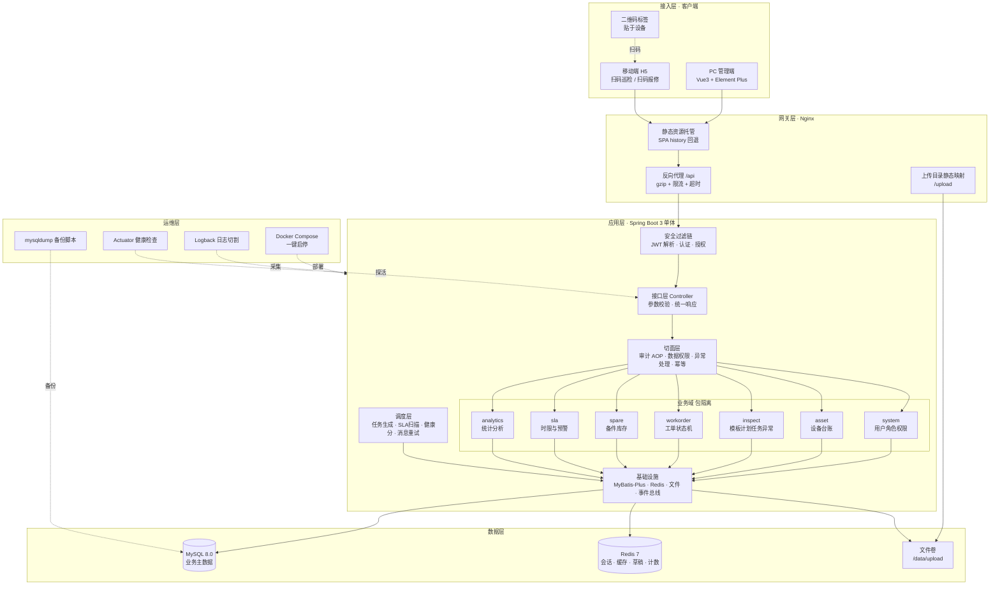
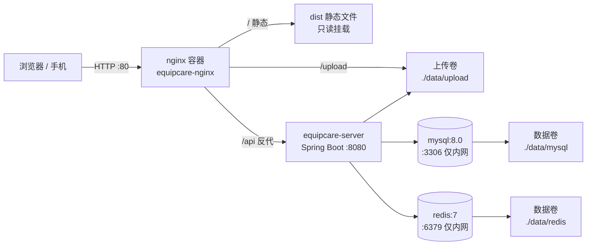
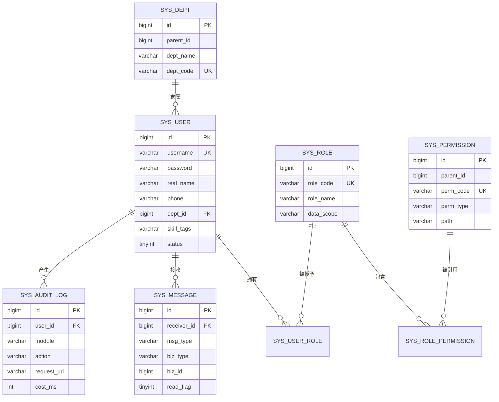
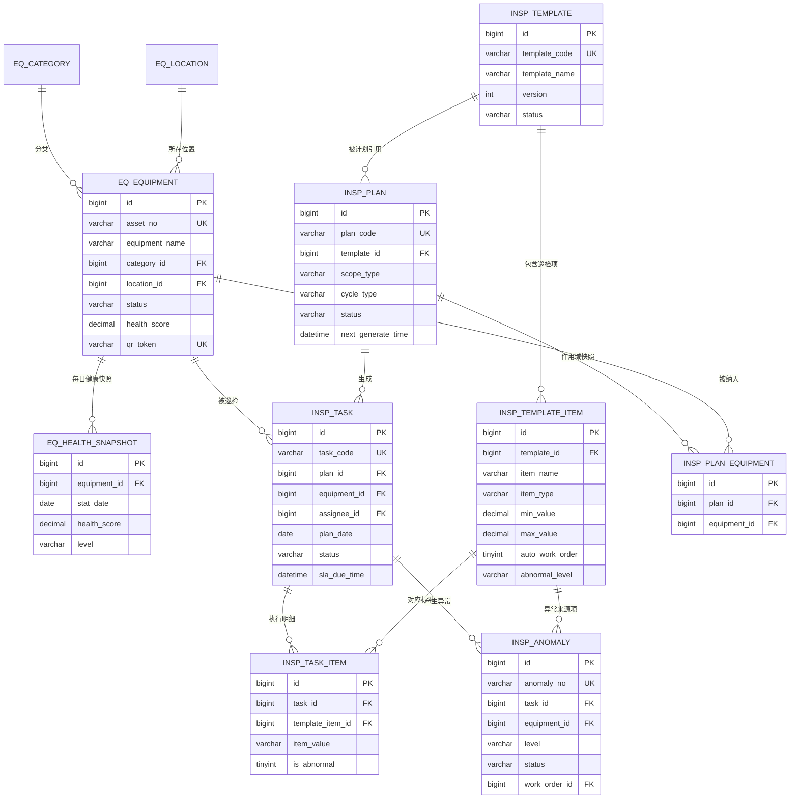
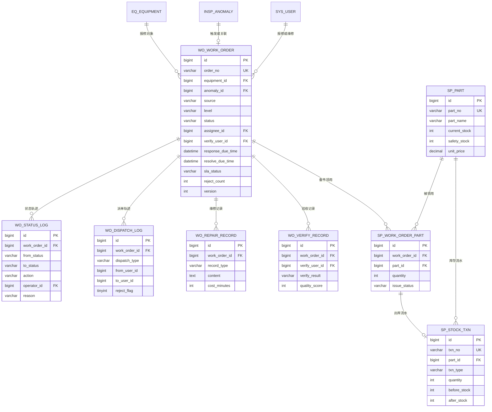

# 巡维云 EquipCare 技术架构与数据库设计

| 项 | 内容 |
|---|---|
| 文档编号 | EC-ARCH-003 |
| 版本 | V1.0 |
| 对应任务 | **D（技术架构图）、E（ER 图）、F（表设计清单）** |

---

## 1. 架构总览（D）

### 1.1 分层架构图



### 1.2 部署拓扑图



**网络与端口约定**

| 服务 | 容器名 | 对外端口 | 说明 |
|---|---|---|---|
| nginx | equipcare-nginx | 80（可改 8080） | 唯一对外入口，其余服务不暴露 |
| server | equipcare-server | 8080（仅 compose 内网） | `expose` 而非 `ports` |
| mysql | equipcare-mysql | 3306（仅内网） | root 密码走 `.env`，不写进镜像 |
| redis | equipcare-redis | 6379（仅内网） | 开启 `requirepass` |

### 1.3 技术选型与理由

| 层 | 选型 | 版本 | 理由 | 替代方案与否决原因 |
|---|---|---|---|---|
| 语言 | Java | 17 | LTS，Spring Boot 3 最低要求 | Java 8 不支持 Boot 3 |
| 框架 | Spring Boot | 3.2.x | 生态成熟、内嵌容器、starter 齐全 | — |
| 安全 | Spring Security + JJWT | 6.x / 0.12.x | 方法级鉴权、过滤器链标准 | Shiro 生态偏旧，Boot 3 适配差 |
| ORM | MyBatis-Plus | 3.5.x | 单表 CRUD 零 SQL、分页插件、逻辑删除、乐观锁 | JPA 复杂查询可读性差，比赛评审更认 SQL |
| 数据库 | MySQL | 8.0 | 事务、窗口函数、CHECK 约束 | — |
| 缓存 | Redis | 7 | 会话、权限缓存、草稿、编号自增、限流 | 单机可用 Caffeine，但演示需要体现分布式能力 |
| 文档 | Springdoc OpenAPI | 2.3.x | 自动生成接口文档，便于评审查阅 | Swagger2 不支持 Boot 3 |
| 前端 | Vue 3 + TS + Vite | 3.4 / 5.x / 5.x | 组合式 API、构建快、类型安全 | — |
| UI | Element Plus | 2.5.x | 表格表单能力强，中后台首选 | — |
| 图表 | ECharts | 5.4.x | 按需引入、图表类型全 | — |
| 部署 | Docker Compose + Nginx | — | 单机一条命令起全套 | K8s 对单机演示过重 |

### 1.4 工程结构（单 Maven 模块 + 包级模块化）

```
equipcare-server
└── src/main/java/com/equipcare
    ├── EquipCareApplication.java
    ├── common/                      # 全局通用，被所有域依赖
    │   ├── result/                  # Result, PageResult, ResultCode
    │   ├── exception/               # BizException, GlobalExceptionHandler
    │   ├── enums/                   # 全局枚举基类
    │   ├── annotation/              # @AuditLog, @DataScope, @Idempotent
    │   ├── aspect/                  # 审计切面、幂等切面
    │   ├── config/                  # Mybatis, Redis, Security, OpenAPI, Web
    │   ├── util/                    # JwtUtil, SecurityUtil, NoGenerator
    │   └── constant/                # 常量与 Redis Key 定义
    ├── system/                      # 用户、角色、权限、部门、字典、消息、审计、文件
    │   ├── controller/ service/ mapper/ entity/ dto/ vo/ converter/
    ├── asset/                       # 设备类别、位置、设备、二维码、健康分
    ├── inspect/                     # 模板、模板项、计划、计划设备、任务、任务项、异常
    ├── workorder/                   # 工单、状态机、派单、维修记录、验收
    ├── spare/                       # 备件、库存流水、工单备件
    ├── sla/                         # SLA 政策、扫描任务
    ├── analytics/                   # 统计聚合
    ├── job/                         # 全部定时任务入口（薄层，只调 service）
    └── integration/                 # 跨域编排服务（如 AnomalyToWorkOrderService）
```

**模块依赖纪律（评审重点）**

1. 依赖方向单向：`controller → service → mapper`，`integration → 各域 service`，`common ← 所有域`。
2. **禁止跨域直接注入对方 Mapper**，只能注入对方 Service 接口。跨域强关联（如巡检转工单）统一放在 `integration` 包，避免 `inspect` 与 `workorder` 双向依赖。
3. 每个域对外只暴露 `XxxService` 接口，实现类 `XxxServiceImpl` 包内可见（`@Service` 但不被其他域 import 实现类）。
4. 领域实体不出 Controller 层，一律转 VO；入参一律 DTO + 校验注解。

### 1.5 关键技术机制

| 机制 | 实现要点 |
|---|---|
| 统一响应 | `Result<T>{code, message, data, traceId, timestamp}`，`code=0` 成功；分页 `PageResult<T>{records, total, pageNum, pageSize}` |
| 异常处理 | `@RestControllerAdvice` 统一捕获 `BizException`（业务）、`MethodArgumentNotValidException`（校验）、`AccessDeniedException`（403）、`Exception`（500，隐藏堆栈只记日志） |
| 参数校验 | DTO 上 `@NotBlank/@Size/@Min/@Pattern`；枚举字段用自定义 `@EnumValue` 校验器；跨字段规则（如驳回原因必填）在 Service 校验 |
| 认证 | 登录签发 access token（2h）+ refresh token（7d）；access 携带 `userId, username, roles`；Redis 存 `token:blacklist:{jti}` 与 `user:status:{id}` |
| 授权 | `@PreAuthorize("hasAuthority('wo:workorder:dispatch')")`；权限码在登录时加载进 `UserDetails.authorities` |
| 数据权限 | `@DataScope(alias="wo")` + MyBatis 拦截器，按角色 `data_scope` 拼接 `AND (assignee_id = ? | dept_id IN (...))` |
| 幂等 | `@Idempotent(key="#dto.anomalyId")`，Redis `SETNX` 5 分钟；同时数据库唯一索引兜底 |
| 并发控制 | 工单状态条件更新；库存 `WHERE current_stock >= qty`；设备编辑 `version` 乐观锁 |
| 事务 | 写操作 `@Transactional(rollbackFor = Exception.class)`；通知、审计等非关键动作放事务提交后（`TransactionSynchronization.afterCommit`） |
| 定时任务 | `@Scheduled(cron=...)` + `sys_job_lock` 表锁；任务体薄，逻辑在 service；执行结果写日志表 |
| 缓存策略 | 字典/权限/类别树：`@Cacheable` 30 分钟，写操作主动 evict；仪表盘 KPI：60 秒短缓存；巡检草稿：24h |
| 文件上传 | 本地卷 + `sys_file` 元数据；白名单 `jpg/jpeg/png/pdf`，单文件 10MB，按 `yyyy/MM/dd/uuid.ext` 分目录；下载走 `/api/files/{id}` 鉴权，不直接暴露物理路径 |
| 审计 | `@AuditLog(module="工单", action="派单")` 切面异步落库，参数脱敏（密码、手机号、身份证） |
| 日志追踪 | 过滤器生成 `traceId` 放 MDC，响应头回传，日志格式含 traceId |

### 1.6 为什么不做微服务（对评审的正面回答）

| 维度 | 单体（本方案） | 微服务 |
|---|---|---|
| 开发效率 | 一个工程、一次启动、调试直观 | 需维护 N 个工程、注册中心、配置中心 |
| 事务一致性 | 本地事务即可保证"任务+异常+工单"强一致 | 需 Seata/Saga，复杂度指数上升 |
| 部署成本 | 2C4G 单机可跑 | 至少 8G 起，演示环境难以保证 |
| 故障排查 | 单一日志流，traceId 贯穿 | 需链路追踪组件 |
| 结论 | 本系统业务量级（万级设备、十万级工单/年）单体完全胜任，模块化包结构已预留拆分可能 | 收益不抵成本 |

---

## 2. 数据库 ER 图（E）

### 2.1 组织与权限域



### 2.2 设备与巡检域



### 2.3 工单与备件域（核心闭环）



---

## 3. 数据库表设计（F）

### 3.0 通用约定

| 约定 | 说明 |
|---|---|
| 主键 | `id BIGINT UNSIGNED AUTO_INCREMENT`，业务编号另设唯一索引字段，不用主键承载业务语义 |
| 审计字段 | 除日志/流水表外，均含 `create_by BIGINT`、`create_time DATETIME`、`update_by BIGINT`、`update_time DATETIME` |
| 逻辑删除 | 主数据表含 `deleted TINYINT DEFAULT 0`（0 正常 / 1 已删），MyBatis-Plus 全局配置；流水、日志表不设 |
| 乐观锁 | 工单、设备、备件含 `version INT DEFAULT 0` |
| 字符集 | `utf8mb4` + `utf8mb4_0900_ai_ci`；引擎 `InnoDB` |
| 时间 | 全库 `Asia/Shanghai`，容器与 JVM 时区统一 |
| 枚举 | 一律 `VARCHAR(32)` 存英文码值，附注释；不使用数字魔法值，便于排障与评审阅读 |
| 金额 | `DECIMAL(12,2)`；数量 `INT`；评分 `DECIMAL(5,2)` |
| 索引命名 | 唯一 `uk_表_字段`，普通 `idx_表_字段`，联合索引按区分度从左到右 |

### 3.1 系统域（12 张）

#### sys_user 用户表

| 字段 | 类型 | 空 | 默认 | 说明 |
|---|---|:--:|---|---|
| id | BIGINT UNSIGNED | N | AI | 主键 |
| username | VARCHAR(50) | N | | 登录名，唯一 |
| password | VARCHAR(100) | N | | BCrypt 密文 |
| real_name | VARCHAR(50) | N | | 真实姓名 |
| phone | VARCHAR(20) | Y | | 手机号，唯一 |
| email | VARCHAR(100) | Y | | 邮箱 |
| dept_id | BIGINT UNSIGNED | Y | | 所属部门 |
| skill_tags | VARCHAR(200) | Y | | 技能标签，逗号分隔，如 `电气,制冷`，派单时参考 |
| status | TINYINT | N | 1 | 1 启用 / 0 禁用 |
| last_login_time | DATETIME | Y | | 最近登录时间 |
| last_login_ip | VARCHAR(50) | Y | | 最近登录 IP |
| + 通用字段 | | | | create_by/create_time/update_by/update_time/deleted |

索引：`uk_username(username)`、`uk_phone(phone)`、`idx_dept_id(dept_id)`

#### sys_role 角色表

| 字段 | 类型 | 空 | 说明 |
|---|---|:--:|---|
| id | BIGINT UNSIGNED | N | 主键 |
| role_code | VARCHAR(50) | N | 唯一，如 `EQUIP_ADMIN` |
| role_name | VARCHAR(50) | N | 角色名称 |
| data_scope | VARCHAR(20) | N | `ALL` / `DEPT` / `SELF` |
| builtin | TINYINT | N | 1 内置不可删（ADMIN） |
| sort | INT | N | 排序 |
| status | TINYINT | N | 1 启用 / 0 停用 |
| remark | VARCHAR(200) | Y | 备注 |

索引：`uk_role_code(role_code)`

#### sys_user_role 用户角色关联

| 字段 | 类型 | 说明 |
|---|---|---|
| id | BIGINT UNSIGNED | 主键 |
| user_id | BIGINT UNSIGNED | 用户 |
| role_id | BIGINT UNSIGNED | 角色 |

索引：`uk_user_role(user_id, role_id)`、`idx_role_id(role_id)`

#### sys_permission 权限表

| 字段 | 类型 | 空 | 说明 |
|---|---|:--:|---|
| id | BIGINT UNSIGNED | N | 主键 |
| parent_id | BIGINT UNSIGNED | N | 父级，0 为根 |
| perm_code | VARCHAR(80) | N | 权限码，唯一，如 `wo:workorder:dispatch` |
| perm_name | VARCHAR(50) | N | 显示名 |
| perm_type | VARCHAR(20) | N | `MENU` / `BUTTON` / `API` |
| path | VARCHAR(120) | Y | 路由路径（MENU 用） |
| component | VARCHAR(120) | Y | 组件路径（MENU 用） |
| icon | VARCHAR(50) | Y | 图标 |
| sort | INT | N | 排序 |
| visible | TINYINT | N | 菜单是否可见 |
| status | TINYINT | N | 状态 |

索引：`uk_perm_code(perm_code)`、`idx_parent_id(parent_id)`

#### sys_role_permission 角色权限关联

| 字段 | 类型 | 说明 |
|---|---|---|
| id | BIGINT UNSIGNED | 主键 |
| role_id | BIGINT UNSIGNED | 角色 |
| permission_id | BIGINT UNSIGNED | 权限 |

索引：`uk_role_perm(role_id, permission_id)`

#### sys_dept 部门表

| 字段 | 类型 | 说明 |
|---|---|---|
| id | BIGINT UNSIGNED | 主键 |
| parent_id | BIGINT UNSIGNED | 父级，0 为根 |
| dept_name | VARCHAR(80) | 部门名 |
| dept_code | VARCHAR(50) | 编码，唯一 |
| leader_user_id | BIGINT UNSIGNED | 负责人 |
| sort | INT | 排序 |
| status | TINYINT | 状态 |
| + 通用字段 | | |

索引：`uk_dept_code(dept_code)`、`idx_parent_id(parent_id)`

#### sys_dict / sys_dict_item 数据字典

| 表 | 字段 | 类型 | 说明 |
|---|---|---|---|
| sys_dict | id, dict_code(UK), dict_name, remark, status, 通用字段 | | 字典类型，如 `fault_type` |
| sys_dict_item | id, dict_code, item_value, item_label, sort, status, 通用字段 | | 字典项，如 `ELECTRIC/电气故障` |

索引：`uk_dict_code(dict_code)`；`uk_item(dict_code, item_value)`

> 用途：故障类型、设备来源、停机原因等可维护枚举走字典；状态机等**受控状态不走字典**，必须硬编码枚举，防止被人为增删状态。

#### sys_audit_log 操作审计

| 字段 | 类型 | 说明 |
|---|---|---|
| id | BIGINT UNSIGNED | 主键 |
| trace_id | VARCHAR(40) | 链路追踪 ID |
| user_id | BIGINT UNSIGNED | 操作人 |
| username | VARCHAR(50) | 冗余，防用户改名后失真 |
| module | VARCHAR(50) | 模块 |
| action | VARCHAR(50) | 动作 |
| request_method | VARCHAR(10) | HTTP 方法 |
| request_uri | VARCHAR(200) | 请求路径 |
| request_param | TEXT | 脱敏后参数，截断 4000 字符 |
| result_status | VARCHAR(20) | `SUCCESS` / `FAIL` |
| error_msg | VARCHAR(1000) | 异常信息 |
| ip | VARCHAR(50) | 客户端 IP |
| user_agent | VARCHAR(300) | UA |
| cost_ms | INT | 耗时 |
| create_time | DATETIME | 时间，不设 update |

索引：`idx_user_time(user_id, create_time)`、`idx_module_time(module, create_time)`、`idx_create_time(create_time)`

#### sys_message 站内消息

| 字段 | 类型 | 说明 |
|---|---|---|
| id | BIGINT UNSIGNED | 主键 |
| receiver_id | BIGINT UNSIGNED | 接收人 |
| title | VARCHAR(120) | 标题 |
| content | VARCHAR(500) | 内容 |
| msg_type | VARCHAR(20) | `TASK` / `WORKORDER` / `SLA` / `SYSTEM` |
| biz_type | VARCHAR(30) | 业务类型，如 `WORK_ORDER` |
| biz_id | BIGINT UNSIGNED | 业务主键，点击跳转用 |
| read_flag | TINYINT | 0 未读 / 1 已读 |
| read_time | DATETIME | 阅读时间 |
| send_status | VARCHAR(20) | `SENT` / `FAILED`，失败由补偿任务重试 |
| create_time | DATETIME | 创建时间 |

索引：`idx_receiver_read(receiver_id, read_flag)`、`idx_biz(biz_type, biz_id)`

#### sys_file 附件元数据

| 字段 | 类型 | 说明 |
|---|---|---|
| id | BIGINT UNSIGNED | 主键 |
| file_name | VARCHAR(200) | 原始文件名 |
| file_path | VARCHAR(300) | 相对路径 |
| file_url | VARCHAR(300) | 访问地址 |
| file_size | BIGINT | 字节 |
| content_type | VARCHAR(100) | MIME |
| md5 | VARCHAR(32) | 去重与完整性校验 |
| biz_type | VARCHAR(30) | 业务类型 |
| biz_id | BIGINT UNSIGNED | 业务主键 |
| upload_user_id | BIGINT UNSIGNED | 上传人 |
| create_time | DATETIME | 上传时间 |

索引：`idx_biz(biz_type, biz_id)`、`idx_md5(md5)`

#### sys_job_lock 定时任务锁

| 字段 | 类型 | 说明 |
|---|---|---|
| id | BIGINT UNSIGNED | 主键 |
| job_name | VARCHAR(60) | 任务名，唯一 |
| lock_until | DATETIME | 锁到期时间 |
| owner | VARCHAR(80) | 持有者（host:pid） |
| last_run_time | DATETIME | 上次执行时间 |
| last_result | VARCHAR(200) | 上次执行结果摘要 |

索引：`uk_job_name(job_name)`

### 3.2 设备域（4 张）

#### eq_category 设备类别

| 字段 | 类型 | 说明 |
|---|---|---|
| id | BIGINT UNSIGNED | 主键 |
| parent_id | BIGINT UNSIGNED | 父级，0 为根（支持二级分类） |
| category_code | VARCHAR(30) | 唯一，同时用于资产编号前缀 |
| category_name | VARCHAR(60) | 类别名 |
| default_template_id | BIGINT UNSIGNED | 默认巡检模板，新建计划时预填 |
| maintain_cycle_days | INT | 建议保养周期（天），仅提示用 |
| sort | INT | 排序 |
| status | TINYINT | 状态 |
| + 通用字段 | | |

索引：`uk_category_code(category_code)`、`idx_parent_id(parent_id)`

#### eq_location 位置

| 字段 | 类型 | 说明 |
|---|---|---|
| id | BIGINT UNSIGNED | 主键 |
| parent_id | BIGINT UNSIGNED | 父级，支持 园区→楼栋→楼层→房间 四级 |
| location_code | VARCHAR(30) | 唯一 |
| location_name | VARCHAR(60) | 名称 |
| location_type | VARCHAR(20) | `PARK` / `BUILDING` / `FLOOR` / `ROOM` |
| full_path | VARCHAR(300) | 全路径冗余，如 `A园区/B栋/3层/301机房`，避免递归查询 |
| sort | INT | 排序 |
| status | TINYINT | 状态 |
| + 通用字段 | | |

索引：`uk_location_code(location_code)`、`idx_parent_id(parent_id)`

#### eq_equipment 设备台账（核心主表）

| 字段 | 类型 | 空 | 说明 |
|---|---|:--:|---|
| id | BIGINT UNSIGNED | N | 主键 |
| asset_no | VARCHAR(40) | N | 资产编号，唯一，服务端生成 `EQ-{CAT}-{6位}` |
| equipment_name | VARCHAR(100) | N | 设备名称 |
| category_id | BIGINT UNSIGNED | N | 类别 |
| location_id | BIGINT UNSIGNED | N | 位置 |
| dept_id | BIGINT UNSIGNED | Y | 归属部门（数据权限用） |
| brand | VARCHAR(60) | Y | 品牌 |
| model | VARCHAR(80) | Y | 型号 |
| spec | VARCHAR(120) | Y | 规格参数 |
| serial_no | VARCHAR(80) | Y | 出厂序列号 |
| manufacturer | VARCHAR(100) | Y | 制造商 |
| supplier | VARCHAR(100) | Y | 供应商 |
| purchase_date | DATE | Y | 采购日期 |
| install_date | DATE | Y | 安装日期 |
| warranty_end_date | DATE | Y | 保修截止 |
| original_value | DECIMAL(12,2) | Y | 原值 |
| responsible_user_id | BIGINT UNSIGNED | Y | 设备责任人 |
| status | VARCHAR(20) | N | `IN_USE` / `IDLE` / `REPAIRING` / `SCRAPPED` |
| health_score | DECIMAL(5,2) | N | 100.00，每日刷新 |
| last_inspect_time | DATETIME | Y | 最近巡检时间 |
| next_inspect_time | DATETIME | Y | 下次应巡检时间（由计划推算） |
| qr_token | VARCHAR(64) | N | 二维码令牌，唯一，可轮换 |
| remark | VARCHAR(500) | Y | 备注 |
| version | INT | N | 乐观锁 |
| + 通用字段 | | | |

索引：`uk_asset_no(asset_no)`、`uk_qr_token(qr_token)`、`idx_category(category_id)`、`idx_location(location_id)`、`idx_status(status)`、`idx_dept(dept_id)`、`idx_responsible(responsible_user_id)`、`idx_health(health_score)`

#### eq_health_snapshot 设备健康快照

| 字段 | 类型 | 说明 |
|---|---|---|
| id | BIGINT UNSIGNED | 主键 |
| equipment_id | BIGINT UNSIGNED | 设备 |
| stat_date | DATE | 统计日期 |
| health_score | DECIMAL(5,2) | 当日得分 |
| fault_score | DECIMAL(5,2) | 故障扣分 F |
| timeout_score | DECIMAL(5,2) | 超时扣分 T |
| anomaly_score | DECIMAL(5,2) | 异常扣分 A |
| overdue_score | DECIMAL(5,2) | 逾期扣分 M |
| bonus_score | DECIMAL(5,2) | 正常巡检加分 R |
| work_order_count | INT | 窗口内工单数 |
| anomaly_count | INT | 窗口内异常数 |
| level | VARCHAR(20) | `HEALTHY` / `SUB_HEALTHY` / `WARNING` / `DANGER` |
| create_time | DATETIME | 计算时间 |

索引：`uk_equip_date(equipment_id, stat_date)`、`idx_stat_date(stat_date)`

> 保留 5 个扣分项字段的意义：评审或管理者质疑某个分数时，可当场拆解"为什么扣了 23 分"，而不是只看到一个结果数字。

### 3.3 巡检域（7 张）

#### insp_template 巡检模板

| 字段 | 类型 | 说明 |
|---|---|---|
| id | BIGINT UNSIGNED | 主键 |
| template_code | VARCHAR(40) | 唯一 |
| template_name | VARCHAR(100) | 名称 |
| category_id | BIGINT UNSIGNED | 适用设备类别 |
| version | INT | 版本号，从 1 递增 |
| status | VARCHAR(20) | `DRAFT` / `PUBLISHED` / `DISABLED` |
| item_count | INT | 巡检项数量冗余 |
| description | VARCHAR(500) | 说明 |
| publish_time | DATETIME | 发布时间 |
| publisher_id | BIGINT UNSIGNED | 发布人 |
| + 通用字段 | | |

索引：`uk_template_code(template_code)`、`idx_category(category_id)`、`idx_status(status)`

#### insp_template_item 巡检项

| 字段 | 类型 | 空 | 说明 |
|---|---|:--:|---|
| id | BIGINT UNSIGNED | N | 主键 |
| template_id | BIGINT UNSIGNED | N | 所属模板 |
| seq_no | INT | N | 序号，模板内唯一 |
| item_name | VARCHAR(100) | N | 检查项名称，如"电机温度" |
| item_type | VARCHAR(20) | N | `NUMBER` / `BOOL` / `ENUM` / `TEXT` |
| unit | VARCHAR(20) | Y | 单位，如 `℃` |
| min_value | DECIMAL(12,3) | Y | 数值下限（含） |
| max_value | DECIMAL(12,3) | Y | 数值上限（含） |
| normal_value | VARCHAR(50) | Y | 正常值：BOOL 填 `1`/`0`；ENUM 填正常项 |
| enum_options | VARCHAR(500) | Y | 枚举项 JSON，如 `["正常","渗漏","异响"]` |
| required | TINYINT | N | 是否必填 |
| check_method | VARCHAR(200) | Y | 检查方法说明 |
| standard_ref | VARCHAR(200) | Y | 标准依据 |
| auto_work_order | TINYINT | N | 异常时是否自动转工单 |
| abnormal_level | VARCHAR(20) | N | 默认异常等级 `LOW`/`MEDIUM`/`HIGH`/`CRITICAL` |
| + 通用字段 | | | |

索引：`uk_template_seq(template_id, seq_no)`、`idx_template(template_id)`

#### insp_plan 巡检计划

| 字段 | 类型 | 说明 |
|---|---|---|
| id | BIGINT UNSIGNED | 主键 |
| plan_code | VARCHAR(40) | 唯一 |
| plan_name | VARCHAR(100) | 计划名称 |
| template_id | BIGINT UNSIGNED | 引用模板（PUBLISHED） |
| scope_type | VARCHAR(20) | `EQUIPMENT` / `CATEGORY` / `LOCATION` |
| scope_config | VARCHAR(500) | 作用域配置 JSON，如 `{"categoryIds":[3,5]}` |
| executor_strategy | VARCHAR(20) | `FIXED` / `DEPT_OWNER` / `ROUND_ROBIN` |
| executor_ids | VARCHAR(300) | 执行人 ID 列表 JSON |
| cycle_type | VARCHAR(20) | `DAILY` / `WEEKLY` / `MONTHLY` |
| cycle_config | VARCHAR(300) | 周期配置 JSON，如 `{"weekDays":[1,3,5],"time":"09:00"}` |
| start_date | DATE | 生效开始 |
| end_date | DATE | 生效结束，空为长期 |
| sla_minutes | INT | 任务执行时限（分钟），超时判逾期 |
| generate_ahead_hours | INT | 提前生成小时数，默认 24 |
| status | VARCHAR(20) | `ENABLED` / `DISABLED` |
| next_generate_time | DATETIME | 下次生成时间 |
| last_generate_time | DATETIME | 上次生成时间 |
| creator_id | BIGINT UNSIGNED | 创建人 |
| + 通用字段 | | |

索引：`uk_plan_code(plan_code)`、`idx_status_next(status, next_generate_time)`、`idx_template(template_id)`

#### insp_plan_equipment 计划作用域快照

| 字段 | 类型 | 说明 |
|---|---|---|
| id | BIGINT UNSIGNED | 主键 |
| plan_id | BIGINT UNSIGNED | 计划 |
| equipment_id | BIGINT UNSIGNED | 设备 |
| seq_no | INT | 轮询顺序（ROUND_ROBIN 用） |
| assignee_id | BIGINT UNSIGNED | 固定分配的执行人（FIXED 策略下预先算好） |
| create_time | DATETIME | 展开时间 |

索引：`uk_plan_equip(plan_id, equipment_id)`、`idx_equipment(equipment_id)`

#### insp_task 巡检任务

| 字段 | 类型 | 空 | 说明 |
|---|---|:--:|---|
| id | BIGINT UNSIGNED | N | 主键 |
| task_code | VARCHAR(40) | N | 唯一，`IT{yyyyMMdd}{6位}` |
| plan_id | BIGINT UNSIGNED | Y | 来源计划，手工创建为空 |
| equipment_id | BIGINT UNSIGNED | N | 设备 |
| template_id | BIGINT UNSIGNED | N | 使用的模板版本快照 |
| plan_date | DATE | N | 计划执行日 |
| assignee_id | BIGINT UNSIGNED | N | 执行人 |
| status | VARCHAR(20) | N | `PENDING`/`IN_PROGRESS`/`SUBMITTED`/`COMPLETED`/`OVERDUE`/`CANCELLED` |
| source | VARCHAR(20) | N | `AUTO` 计划生成 / `MANUAL` 手工创建 |
| start_time | DATETIME | Y | 开始时间 |
| submit_time | DATETIME | Y | 提交时间 |
| finish_time | DATETIME | Y | 完成时间 |
| result | VARCHAR(20) | Y | `NORMAL` / `ABNORMAL` |
| abnormal_count | INT | N | 异常项数 |
| sla_due_time | DATETIME | N | 应完成时限 |
| overdue_flag | TINYINT | N | 是否逾期 |
| qr_verified | TINYINT | N | 是否扫码进入 |
| remark | VARCHAR(300) | Y | 备注 |
| + 通用字段 | | | |

索引：`uk_plan_equip_date(plan_id, equipment_id, plan_date)`、`uk_task_code(task_code)`、`idx_assignee_status(assignee_id, status)`、`idx_equipment_date(equipment_id, plan_date)`、`idx_status_due(status, sla_due_time)`

#### insp_task_item 巡检任务明细

| 字段 | 类型 | 说明 |
|---|---|---|
| id | BIGINT UNSIGNED | 主键 |
| task_id | BIGINT UNSIGNED | 任务 |
| template_item_id | BIGINT UNSIGNED | 对应模板项（含快照意义） |
| item_name | VARCHAR(100) | 名称快照，防模板改名影响历史 |
| item_type | VARCHAR(20) | 类型快照 |
| item_value | VARCHAR(500) | 填写值 |
| is_abnormal | TINYINT | 是否异常（服务端复算结果） |
| abnormal_level | VARCHAR(20) | 异常等级 |
| remark | VARCHAR(300) | 说明 |
| attachment_ids | VARCHAR(300) | 附件 ID JSON |
| create_time | DATETIME | 记录时间 |

索引：`uk_task_item(task_id, template_item_id)`、`idx_task(task_id)`

#### insp_anomaly 巡检异常

| 字段 | 类型 | 说明 |
|---|---|---|
| id | BIGINT UNSIGNED | 主键 |
| anomaly_no | VARCHAR(40) | 唯一，`AN{yyyyMMdd}{6位}` |
| task_id | BIGINT UNSIGNED | 来源任务，扫码报修可为空 |
| equipment_id | BIGINT UNSIGNED | 设备 |
| template_item_id | BIGINT UNSIGNED | 来源巡检项 |
| item_name | VARCHAR(100) | 名称快照 |
| level | VARCHAR(20) | `LOW`/`MEDIUM`/`HIGH`/`CRITICAL` |
| description | VARCHAR(500) | 异常描述 |
| attachment_ids | VARCHAR(300) | 现场照片 |
| status | VARCHAR(20) | `OPEN` 待处置 / `CONVERTED` 已转单 / `CLOSED` 已关闭 |
| work_order_id | BIGINT UNSIGNED | 关联工单 |
| reporter_id | BIGINT UNSIGNED | 上报人 |
| report_time | DATETIME | 上报时间 |
| close_time | DATETIME | 关闭时间 |
| close_remark | VARCHAR(300) | 关闭原因 |
| create_time | DATETIME | 创建时间 |

索引：`uk_anomaly_no(anomaly_no)`、`idx_equipment_time(equipment_id, report_time)`、`idx_status(status)`、`idx_work_order(work_order_id)`、`idx_task(task_id)`

### 3.4 工单域（5 张）

#### wo_work_order 维修工单（核心表）

| 字段 | 类型 | 空 | 说明 |
|---|---|:--:|---|
| id | BIGINT UNSIGNED | N | 主键 |
| order_no | VARCHAR(40) | N | 唯一，`WO{yyyyMMdd}{5位}` |
| title | VARCHAR(120) | N | 工单标题，如"3 号空压机异响" |
| source | VARCHAR(20) | N | `INSPECT` / `ANOMALY` / `MANUAL` / `PLAN_MAINTAIN` |
| source_id | BIGINT UNSIGNED | Y | 来源单据 ID |
| equipment_id | BIGINT UNSIGNED | N | 设备 |
| anomaly_id | BIGINT UNSIGNED | Y | 触发异常，**唯一索引防重复建单** |
| fault_type | VARCHAR(30) | N | 故障类型（字典） |
| fault_desc | VARCHAR(1000) | N | 故障描述 |
| level | VARCHAR(10) | N | `P1` / `P2` / `P3` / `P4` |
| status | VARCHAR(30) | N | 见状态机，7 态 |
| reporter_id | BIGINT UNSIGNED | N | 报修人 |
| report_time | DATETIME | N | 报修时间 |
| dispatcher_id | BIGINT UNSIGNED | Y | 派单人 |
| dispatch_time | DATETIME | Y | 派单时间 |
| assignee_id | BIGINT UNSIGNED | Y | 维修人 |
| accept_time | DATETIME | Y | 接单时间 |
| response_due_time | DATETIME | Y | 响应时限 |
| resolve_due_time | DATETIME | Y | 修复时限（挂起后顺延） |
| suspend_start_time | DATETIME | Y | 最近一次挂起开始 |
| suspend_total_minutes | INT | N | 累计挂起分钟数 |
| start_repair_time | DATETIME | Y | 开始维修时间 |
| submit_verify_time | DATETIME | Y | 提交验收时间 |
| repair_summary | VARCHAR(1000) | Y | 维修总结 |
| labor_hours | DECIMAL(6,2) | Y | 工时（小时） |
| verify_user_id | BIGINT UNSIGNED | Y | 验收人 |
| verify_time | DATETIME | Y | 验收时间 |
| verify_result | VARCHAR(20) | Y | `PASS` / `REJECT` |
| verify_remark | VARCHAR(500) | Y | 验收意见 |
| quality_score | TINYINT | Y | 质量分 1–5 |
| actual_finish_time | DATETIME | Y | 实际修复完成时间（MTTR 计算基准） |
| close_time | DATETIME | Y | 关单时间 |
| spare_cost | DECIMAL(12,2) | N | 备件成本，出库时累加 |
| reject_count | INT | N | 验收驳回次数 |
| reject_dispatch_count | INT | N | 拒接次数 |
| sla_status | VARCHAR(20) | N | `NORMAL` / `WARN` / `OVERDUE` / `PAUSED` |
| overdue_flag | TINYINT | N | 是否超时完结 |
| prev_equipment_status | VARCHAR(20) | Y | 创建前设备状态，取消时回滚用 |
| cancel_reason | VARCHAR(300) | Y | 取消原因 |
| version | INT | N | 乐观锁，状态机必须校验 |
| + 通用字段 | | | |

索引：`uk_order_no(order_no)`、`uk_anomaly_id(anomaly_id)`、`idx_equipment_status(equipment_id, status)`、`idx_assignee_status(assignee_id, status)`、`idx_status_time(status, report_time)`、`idx_sla(sla_status, resolve_due_time)`

> `uk_anomaly_id` 是本设计最关键的防重手段之一。MySQL 唯一索引允许多个 NULL，因此手工报修（无异常）不受影响，而同一异常绝不可能产生两张工单。

#### wo_status_log 工单状态流转日志

| 字段 | 类型 | 说明 |
|---|---|---|
| id | BIGINT UNSIGNED | 主键 |
| work_order_id | BIGINT UNSIGNED | 工单 |
| from_status | VARCHAR(30) | 原状态，创建时为 NULL |
| to_status | VARCHAR(30) | 新状态 |
| action | VARCHAR(30) | 动作码，与状态机一致 |
| operator_id | BIGINT UNSIGNED | 操作人 |
| operator_role | VARCHAR(50) | 操作人角色快照 |
| reason | VARCHAR(300) | 原因/说明 |
| cost_minutes | INT | 在上一状态停留分钟数，时间轴展示用 |
| create_time | DATETIME | 时间 |

索引：`idx_order_time(work_order_id, create_time)`

> 该表只允许 INSERT，代码层不提供 update/delete 方法，数据库账号权限上不授予该表 UPDATE/DELETE（生产环境）。

#### wo_dispatch_log 派单轨迹

| 字段 | 类型 | 说明 |
|---|---|---|
| id | BIGINT UNSIGNED | 主键 |
| work_order_id | BIGINT UNSIGNED | 工单 |
| dispatch_type | VARCHAR(20) | `ASSIGN` 首次派单 / `TRANSFER` 转派 / `REASSIGN` 强制转派 / `REVOKE` 撤回 |
| from_user_id | BIGINT UNSIGNED | 原维修人（转派时） |
| to_user_id | BIGINT UNSIGNED | 新维修人 |
| dispatcher_id | BIGINT UNSIGNED | 派单人 |
| dispatch_time | DATETIME | 派单时间 |
| accept_time | DATETIME | 接单时间 |
| reject_flag | TINYINT | 是否被拒接 |
| reject_reason | VARCHAR(300) | 拒接原因 |
| remark | VARCHAR(300) | 备注 |

索引：`idx_order(work_order_id)`、`idx_to_user(to_user_id)`

#### wo_repair_record 维修过程记录

| 字段 | 类型 | 说明 |
|---|---|---|
| id | BIGINT UNSIGNED | 主键 |
| work_order_id | BIGINT UNSIGNED | 工单 |
| record_type | VARCHAR(20) | `DIAGNOSIS` / `PROCESS` / `FINISH` / `OTHER` |
| content | VARCHAR(2000) | 记录内容 |
| cost_minutes | INT | 本次耗时 |
| attachment_ids | VARCHAR(300) | 附件 |
| operator_id | BIGINT UNSIGNED | 记录人 |
| create_time | DATETIME | 时间 |

索引：`idx_order_type(work_order_id, record_type)`、`idx_order_time(work_order_id, create_time)`

#### wo_verify_record 验收记录

| 字段 | 类型 | 说明 |
|---|---|---|
| id | BIGINT UNSIGNED | 主键 |
| work_order_id | BIGINT UNSIGNED | 工单 |
| verify_user_id | BIGINT UNSIGNED | 验收人 |
| verify_result | VARCHAR(20) | `PASS` / `REJECT` |
| quality_score | TINYINT | 质量分 1–5，PASS 必填 |
| remark | VARCHAR(500) | 意见，REJECT 必填且 ≥10 字 |
| attachment_ids | VARCHAR(300) | 验收照片 |
| verify_time | DATETIME | 验收时间 |

索引：`idx_order(work_order_id)`、`idx_verify_user(verify_user_id)`

### 3.5 备件域（3 张）

#### sp_part 备件档案

| 字段 | 类型 | 说明 |
|---|---|---|
| id | BIGINT UNSIGNED | 主键 |
| part_no | VARCHAR(40) | 唯一，`SP-{6位}` |
| part_name | VARCHAR(100) | 名称 |
| category | VARCHAR(50) | 分类 |
| spec | VARCHAR(120) | 规格型号 |
| unit | VARCHAR(20) | 单位 |
| brand | VARCHAR(60) | 品牌 |
| safety_stock | INT | 安全库存 |
| current_stock | INT | 当前库存，`CHECK (current_stock >= 0)` |
| unit_price | DECIMAL(12,2) | 单价 |
| warehouse_location | VARCHAR(60) | 库位 |
| supplier | VARCHAR(100) | 供应商 |
| status | TINYINT | 1 启用 / 0 停用 |
| version | INT | 乐观锁 |
| + 通用字段 | | |

索引：`uk_part_no(part_no)`、`idx_status_stock(status, current_stock)`

#### sp_stock_txn 库存流水

| 字段 | 类型 | 说明 |
|---|---|---|
| id | BIGINT UNSIGNED | 主键 |
| txn_no | VARCHAR(40) | 唯一，`TX{yyyyMMdd}{6位}` |
| part_id | BIGINT UNSIGNED | 备件 |
| txn_type | VARCHAR(20) | `IN` / `OUT` / `RETURN` / `ADJUST` |
| biz_type | VARCHAR(30) | `WORK_ORDER` / `PURCHASE` / `RETURN` / `CHECK` |
| biz_id | BIGINT UNSIGNED | 关联业务单 |
| quantity | INT | 变动数量（入库正、出库正、调整可负） |
| before_stock | INT | 变动前库存快照 |
| after_stock | INT | 变动后库存快照 |
| unit_price | DECIMAL(12,2) | 单价快照 |
| amount | DECIMAL(12,2) | 金额 |
| operator_id | BIGINT UNSIGNED | 操作人 |
| txn_time | DATETIME | 发生时间 |
| remark | VARCHAR(300) | 备注/冲正说明 |

索引：`uk_txn_no(txn_no)`、`idx_part_time(part_id, txn_time)`、`idx_biz(biz_type, biz_id)`

#### sp_work_order_part 工单备件

| 字段 | 类型 | 说明 |
|---|---|---|
| id | BIGINT UNSIGNED | 主键 |
| work_order_id | BIGINT UNSIGNED | 工单 |
| part_id | BIGINT UNSIGNED | 备件 |
| part_name | VARCHAR(100) | 名称快照 |
| quantity | INT | 申请数量 |
| unit_price | DECIMAL(12,2) | 单价快照 |
| amount | DECIMAL(12,2) | 金额 |
| apply_user_id | BIGINT UNSIGNED | 申请人（维修人） |
| apply_time | DATETIME | 申请时间 |
| audit_user_id | BIGINT UNSIGNED | 审批人 |
| audit_time | DATETIME | 审批时间 |
| issue_status | VARCHAR(20) | `APPLIED` / `ISSUED` / `REJECTED` / `RETURNED` |
| issue_time | DATETIME | 出库时间 |
| txn_id | BIGINT UNSIGNED | 对应出库流水 |
| remark | VARCHAR(300) | 备注 |

索引：`idx_order(work_order_id)`、`idx_part(part_id)`、`idx_status(issue_status)`

### 3.6 SLA 域（1 张）

#### sla_policy SLA 政策

| 字段 | 类型 | 说明 |
|---|---|---|
| id | BIGINT UNSIGNED | 主键 |
| policy_name | VARCHAR(60) | 政策名称 |
| level | VARCHAR(10) | 适用等级 `P1`–`P4`，唯一 |
| response_minutes | INT | 响应时限（分钟） |
| resolve_minutes | INT | 修复时限（分钟） |
| warn_percent | INT | 预警阈值百分比，默认 80 |
| escalate_role_code | VARCHAR(50) | 超时升级通知角色 |
| enabled | TINYINT | 是否启用 |
| remark | VARCHAR(300) | 说明 |
| + 通用字段 | | |

索引：`uk_level(level)`

### 3.7 表清单汇总（32 张）

| 域 | 表名 | 中文 | 预估数据量/年 | 是否含逻辑删除 |
|---|---|---|---:|---|
| 系统 | sys_user | 用户 | 500 | 是 |
| 系统 | sys_role | 角色 | 20 | 是 |
| 系统 | sys_user_role | 用户角色 | 1,000 | 否 |
| 系统 | sys_permission | 权限 | 300 | 是 |
| 系统 | sys_role_permission | 角色权限 | 3,000 | 否 |
| 系统 | sys_dept | 部门 | 100 | 是 |
| 系统 | sys_dict | 字典类型 | 50 | 是 |
| 系统 | sys_dict_item | 字典项 | 500 | 是 |
| 系统 | sys_audit_log | 审计日志 | 30 万 | 否 |
| 系统 | sys_message | 站内消息 | 20 万 | 否 |
| 系统 | sys_file | 附件 | 10 万 | 否 |
| 系统 | sys_job_lock | 任务锁 | 10 | 否 |
| 设备 | eq_category | 设备类别 | 100 | 是 |
| 设备 | eq_location | 位置 | 500 | 是 |
| 设备 | eq_equipment | 设备台账 | 5,000 | 是 |
| 设备 | eq_health_snapshot | 健康快照 | 180 万 | 否 |
| 巡检 | insp_template | 巡检模板 | 100 | 是 |
| 巡检 | insp_template_item | 巡检项 | 2,000 | 否 |
| 巡检 | insp_plan | 巡检计划 | 200 | 是 |
| 巡检 | insp_plan_equipment | 计划设备快照 | 1 万 | 否 |
| 巡检 | insp_task | 巡检任务 | 30 万 | 否 |
| 巡检 | insp_task_item | 任务明细 | 300 万 | 否 |
| 巡检 | insp_anomaly | 巡检异常 | 3 万 | 否 |
| 工单 | wo_work_order | 维修工单 | 3 万 | 否 |
| 工单 | wo_status_log | 状态日志 | 15 万 | 否 |
| 工单 | wo_dispatch_log | 派单日志 | 5 万 | 否 |
| 工单 | wo_repair_record | 维修记录 | 10 万 | 否 |
| 工单 | wo_verify_record | 验收记录 | 4 万 | 否 |
| 备件 | sp_part | 备件档案 | 1,000 | 是 |
| 备件 | sp_stock_txn | 库存流水 | 5 万 | 否 |
| 备件 | sp_work_order_part | 工单备件 | 6 万 | 否 |
| SLA | sla_policy | SLA 政策 | 4 | 是 |

**容量评估**：上述量级下，单表最大为 `insp_task_item`（300 万/年），MySQL 8 单机完全支撑；`eq_health_snapshot` 180 万/年建议按年归档，超过 2 年数据转入历史表。

### 3.8 初始化数据（data.sql 必含）

| 数据 | 内容 |
|---|---|
| 部门 | 总经办、设备科、巡检一组、维修班组 |
| 角色 | 6 个角色 + 数据范围 + 权限关联 |
| 权限 | 与本文档权限矩阵完全一致的 53 条权限记录 |
| 用户 | admin / equip01 / inspect01 / repair01 / verify01 / manager01，统一初始密码 `Equip@123`（首次登录强制修改） |
| 设备类别 | 空调机组、空压机、配电柜、水泵、电梯、消防设施 |
| 位置 | A 园区 / B 栋 / 1–3 层 / 各机房 |
| 设备 | 24 台示例设备，覆盖 4 种状态，含真实型号与位置 |
| 模板 | 3 套（空调机组日常巡检 8 项、配电柜月度巡检 10 项、消防设施季度巡检 6 项） |
| 计划 | 3 条（日检、周检、月检），启用状态 |
| 备件 | 12 种常用备件，含 3 种低于安全库存用于演示预警 |
| SLA | P1–P4 四条政策 |
| 历史数据 | 由 `DataInitRunner` 生成近 30 天真实业务流水的巡检任务、异常、工单（状态分布合理，非随机噪声），保证演示时图表有真实曲线 |

> 强调：演示数据的生成也走**业务服务方法**而非直接 insert，确保数据满足全部业务约束（例如工单状态日志与状态一致、库存流水前后快照连续）。这样"数据真实"经得起追问。
