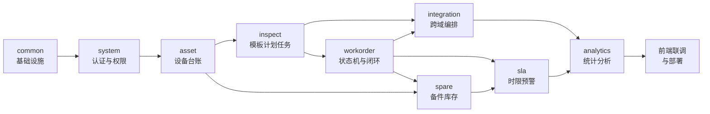

# 巡维云 EquipCare 模块划分、前端路由与接口规划

| 项 | 内容 |
|---|---|
| 文档编号 | EC-DESIGN-004 |
| 版本 | V1.0 |
| 对应任务 | **G（后端模块划分）、H（前端路由规划）、I（REST API 规划）** |

---

## 1. 后端模块划分（G）

### 1.1 模块总览

| 模块 | 包路径 | 职责边界 | 对外暴露的 Service | 依赖模块 |
|---|---|---|---|---|
| 通用 | `common` | 统一响应、异常、枚举基类、JWT、审计切面、数据权限、Redis 封装、编号生成 | 工具类与基类，无业务 Service | 无 |
| 认证 | `system.auth` | 登录、登出、刷新令牌、当前用户信息、菜单树 | `AuthService` | common、system |
| 系统 | `system` | 用户、角色、权限、部门、字典、消息、文件、审计、任务锁 | `UserService`、`RoleService`、`PermissionService`、`DeptService`、`DictService`、`MessageService`、`FileService`、`AuditService` | common |
| 设备 | `asset` | 设备类别、位置、设备台账、二维码、健康分计算 | `EquipmentService`、`CategoryService`、`LocationService`、`HealthScoreService` | common、system（取用户信息） |
| 巡检 | `inspect` | 模板、模板项、计划、计划设备快照、任务、任务项、异常 | `TemplateService`、`PlanService`、`TaskService`、`AnomalyService`、`TaskGenerateService` | common、asset、system |
| 工单 | `workorder` | 工单 CRUD、状态机、派单、维修记录、验收 | `WorkOrderService`、`WorkOrderStateMachine`、`DispatchService`、`RepairRecordService`、`VerifyService` | common、asset、system、spare（成本归集） |
| 备件 | `spare` | 备件档案、库存流水、工单备件申请与出库 | `PartService`、`StockService`、`WorkOrderPartService` | common、system |
| SLA | `sla` | 政策配置、时限计算、超时扫描与升级 | `SlaPolicyService`、`SlaScanService` | common、workorder（只读查询） |
| 分析 | `analytics` | 仪表盘 KPI、趋势、排行、SLA 达成、成本 | `DashboardService`、`ReportService` | 各域 Mapper（只读聚合） |
| 编排 | `integration` | 跨域业务编排，避免域间双向依赖 | `AnomalyToWorkOrderService`（异常转单）、`WorkOrderCloseService`（关单联动） | inspect、workorder、asset、spare |
| 调度 | `job` | 定时任务入口（薄层，仅调用 Service 并记录执行结果） | 无（`@Component`） | 各域 Service |

### 1.2 各模块关键类清单

#### common

| 类 | 职责 |
|---|---|
| `Result<T>` / `PageResult<T>` / `ResultCode` | 统一响应结构与错误码枚举（含 `WO_ILLEGAL_TRANSITION`、`WO_SELF_VERIFY_FORBIDDEN` 等） |
| `BizException` | 业务异常，携带 `ResultCode` 与参数 |
| `GlobalExceptionHandler` | 统一异常出口，按类型映射 HTTP 状态与错误码 |
| `JwtUtil` / `JwtAuthenticationFilter` / `SecurityConfig` | 令牌签发解析、过滤链、放行白名单 |
| `SecurityUtil` | 获取当前用户 ID / 角色 / 权限，禁止在 Service 里直接读 `SecurityContextHolder` |
| `@AuditLog` + `AuditAspect` | 审计采集，`afterCommit` 异步落库 |
| `@DataScope` + `DataScopeInterceptor` | 数据权限 SQL 注入 |
| `@Idempotent` + `IdempotentAspect` | 幂等控制 |
| `NoGenerator` | 业务编号生成：`WO`/`IT`/`AN`/`TX`/`EQ`，Redis `INCR` + 日期分段 |
| `RedisKeys` | 全项目 Redis Key 常量集中定义，禁止散落字符串 |
| `BaseEntity` | 审计字段父类，配合 MyBatis-Plus 自动填充 |

#### inspect

| 类 | 职责 | 说明 |
|---|---|---|
| `TemplateService` | 模板增改、发布、版本升级、停用 | 发布时校验巡检项完整性与 `seq_no` 唯一 |
| `PlanService` | 计划 CRUD、启停、作用域展开、下次生成时间计算 | 展开结果写 `insp_plan_equipment` |
| `TaskGenerateService.generateByPlan(planId, planDate)` | 按计划生成任务，幂等 | `job` 与"立即生成"按钮共用 |
| `TaskService` | 我的任务、详情、开始、草稿、提交 | 提交方法为核心事务入口 |
| `TaskServiceImpl.submit()` | 校验 + 落库 + 复算异常 + 调转单编排 | `@Transactional` |
| `AnomalyService` | 异常查询、关闭、手工转单入口 | 手工转单委托 `integration` |

#### workorder

| 类 | 职责 | 说明 |
|---|---|---|
| `WorkOrderStateMachine` | 状态转移唯一入口 | 内部转移表 + 守卫 + 副作用回调 |
| `WorkOrderAction`（枚举） | 12 个动作码 | 与接口路径一一对应 |
| `WorkOrderStatus`（枚举） | 7 个状态码 + 终态判断 | 附 `isFinal()`、`allowedActions()` |
| `DispatchService` | 派单、转派、撤回、接单、拒接 | 内部委托状态机 |
| `RepairRecordService` | 维修记录追加、挂起恢复、提交验收 | 提交验收前执行 4 项前置校验 |
| `VerifyService` | 验收通过/驳回 | 自验收校验在此处硬拦截 |
| `WorkOrderQueryService` | 列表、详情聚合、时间轴组装 | 详情聚合 6 张表，需避免 N+1 |

#### 状态机的代码骨架（示意，非最终实现）

```java
public interface WorkOrderStateMachine {
    void transition(Long orderId, WorkOrderAction action, Long operatorId, String reason);
}

// 转移表：状态 -> (动作 -> 目标状态)
private static final Map<WorkOrderStatus, Map<WorkOrderAction, WorkOrderStatus>> TABLE = Map.of(
    PENDING_DISPATCH, Map.of(DISPATCH, PENDING_ACCEPT, CANCEL, CANCELLED),
    PENDING_ACCEPT,   Map.of(ACCEPT, IN_PROGRESS, REJECT_DISPATCH, PENDING_DISPATCH,
                             TRANSFER, PENDING_ACCEPT, REVOKE, PENDING_DISPATCH, CANCEL, CANCELLED),
    IN_PROGRESS,      Map.of(SUSPEND, SUSPENDED, SUBMIT_VERIFY, PENDING_VERIFY,
                             FORCE_TRANSFER, IN_PROGRESS),
    SUSPENDED,        Map.of(RESUME, IN_PROGRESS, SUBMIT_VERIFY, PENDING_VERIFY),
    PENDING_VERIFY,   Map.of(VERIFY_PASS, COMPLETED, VERIFY_REJECT, IN_PROGRESS)
);
```

转移流程固定为四步：**① 查工单并校验当前状态 → ② 查表得目标状态，无则抛非法转移 → ③ 执行守卫（角色、本人、前置数据）→ ④ 条件更新 + 写状态日志 + 执行副作用**。

#### integration

| 类 | 职责 |
|---|---|
| `AnomalyToWorkOrderService.handleAfterTaskSubmit(taskId)` | 遍历异常 → 判定转单/合并 → 建单 → 关联 → 置设备状态 → 发消息 |
| `WorkOrderCloseService.onCompleted(orderId)` | 设备状态复位、备件成本归集、健康分重算、SLA 结算、通知 |
| `WorkOrderCloseService.onCancelled(orderId)` | 设备状态回滚、异常回退为 `OPEN` |

### 1.3 定时任务清单

| 任务 | Cron | 频率 | 职责 | 幂等/防重 |
|---|---|---|---|---|
| `InspectTaskGenerateJob` | `0 5 0 * * ?` | 每日 00:05 | 生成巡检任务 | `sys_job_lock` + 唯一键 |
| `InspectOverdueJob` | `0 */10 * * * ?` | 每 10 分钟 | 巡检任务置 `OVERDUE` | 条件更新 `status IN (PENDING, IN_PROGRESS)` |
| `SlaScanJob` | `0 * * * * ?` | 每分钟 | SLA 预警/超时扫描 | `sla_status` 状态机式更新，避免重复通知 |
| `HealthScoreJob` | `0 0 2 * * ?` | 每日 02:00 | 全量重算健康分 | 按 `stat_date` 唯一键覆盖写 |
| `StockAlertJob` | `0 0 8 * * ?` | 每日 08:00 | 低库存汇总提醒 | 当日只发一次（Redis 标记） |
| `MessageRetryJob` | `0 */5 * * * ?` | 每 5 分钟 | 重发 `FAILED` 消息 | 重试 3 次后置 `DEAD` |
| `AuditArchiveJob` | `0 30 3 * * ?` | 每日 03:30 | 清理 180 天前审计日志 | 分批删除，每批 5000 条 |
| `DraftCleanJob` | `0 0 4 * * ?` | 每日 04:00 | 清理过期巡检草稿 | Redis TTL 兜底 |

**任务执行记录**：统一写 `sys_job_log`（任务名、开始/结束时间、处理条数、结果、异常摘要），系统管理页可查，避免"任务悄悄挂了没人知道"。

### 1.4 模块开发顺序与依赖关系



---

## 2. 前端页面路由规划（H）

### 2.1 工程结构

```
equipcare-web
├── src
│   ├── api/                 # 按域拆分的接口封装，与后端模块一一对应
│   │   ├── request.ts       # axios 实例：token 注入、401 跳转、错误提示、loading
│   │   ├── auth.ts  equipment.ts  inspect.ts  workorder.ts  spare.ts
│   │   └── sla.ts   analytics.ts  system.ts
│   ├── assets/              # 静态资源、图标
│   ├── components/          # 通用组件
│   │   ├── BaseTable/       # 表格 + 分页 + 空态 + 加载态封装
│   │   ├── BaseChart/       # ECharts 封装，自动 resize、主题跟随
│   │   ├── StatusTag/       # 工单/任务状态标签，颜色统一映射
│   │   ├── PageHeader/  SearchForm/  FileUpload/  ImagePreview/
│   │   └── StateWrapper/    # loading / empty / error / success 四态容器
│   ├── composables/         # useTable、usePermission、useDict、useDownload
│   ├── directives/          # v-permission 按钮级权限
│   ├── layouts/             # 主布局（侧栏+顶栏）、移动端布局
│   ├── router/              # 静态路由 + 动态权限路由
│   ├── stores/              # user / app / dict / message
│   ├── styles/              # 变量、主题、Element 覆盖
│   ├── types/               # 与后端 DTO/VO 对应的 TS 类型
│   ├── utils/               # 日期、金额、枚举字典、校验
│   └── views/               # 页面，按业务域分目录
```

### 2.2 PC 端路由表

| 路径 | 路由名 | 页面文件 | 权限码 | 菜单 | 说明 |
|---|---|---|---|:--:|---|
| `/login` | Login | `views/login/index.vue` | 免登录 | 否 | 登录页，含验证码 |
| `/` | Layout | `layouts/default.vue` | 已登录 | — | 主框架 |
| `/dashboard` | Dashboard | `views/dashboard/index.vue` | `dashboard:view` | 是 | 工作台：待办、KPI、快捷入口 |
| `/equipment/list` | EquipmentList | `views/equipment/list.vue` | `asset:equipment:view` | 是 | 设备台账（查询/新增/编辑/删除/导入/导出） |
| `/equipment/detail/:id` | EquipmentDetail | `views/equipment/detail.vue` | `asset:equipment:view` | 隐藏 | 设备档案：信息/健康趋势/巡检历史/工单历史/备件消耗 |
| `/equipment/category` | EquipmentCategory | `views/equipment/category.vue` | `asset:category:manage` | 是 | 类别树维护 |
| `/equipment/location` | EquipmentLocation | `views/equipment/location.vue` | `asset:location:manage` | 是 | 位置树维护 |
| `/equipment/qrcode` | EquipmentQrcode | `views/equipment/qrcode.vue` | `asset:equipment:qrcode` | 是 | 批量生成/打印二维码 |
| `/inspect/template` | InspectTemplate | `views/inspect/template.vue` | `inspect:template:view` | 是 | 模板列表 |
| `/inspect/template/edit/:id?` | InspectTemplateEdit | `views/inspect/template-edit.vue` | `inspect:template:manage` | 隐藏 | 模板与巡检项编辑、发布 |
| `/inspect/plan` | InspectPlan | `views/inspect/plan.vue` | `inspect:plan:view` | 是 | 计划列表（启用/停用/立即生成） |
| `/inspect/plan/edit/:id?` | InspectPlanEdit | `views/inspect/plan-edit.vue` | `inspect:plan:manage` | 隐藏 | 计划编辑，含作用域设备选择 |
| `/inspect/task` | InspectTask | `views/inspect/task.vue` | `inspect:task:view` | 是 | 全部任务（管理视角，按人/状态/日期筛选） |
| `/inspect/my-task` | MyInspectTask | `views/inspect/my-task.vue` | `inspect:task:execute` | 是 | 我的任务（执行视角，卡片列表） |
| `/inspect/task/execute/:id` | InspectTaskExecute | `views/inspect/execute.vue` | `inspect:task:execute` | 隐藏 | 执行页：逐项填写、异常标记、拍照上传 |
| `/inspect/anomaly` | InspectAnomaly | `views/inspect/anomaly.vue` | `inspect:anomaly:view` | 是 | 异常池（转单/关闭） |
| `/workorder/list` | WorkOrderList | `views/workorder/list.vue` | `wo:workorder:view` | 是 | 工单列表（状态 Tab + 多条件） |
| `/workorder/dispatch-pool` | DispatchPool | `views/workorder/dispatch-pool.vue` | `wo:workorder:dispatch` | 是 | 待派单池，含维修人负载展示 |
| `/workorder/my` | MyWorkOrder | `views/workorder/my.vue` | `wo:workorder:accept` | 是 | 我的工单（待接单/维修中/已挂起） |
| `/workorder/verify` | VerifyList | `views/workorder/verify.vue` | `wo:workorder:verify` | 是 | 待验收列表 |
| `/workorder/detail/:id` | WorkOrderDetail | `views/workorder/detail.vue` | `wo:workorder:view` | 隐藏 | 工单详情：时间轴、记录、备件、附件、SLA |
| `/spare/part` | SparePart | `views/spare/part.vue` | `spare:part:view` | 是 | 备件档案，低库存高亮 |
| `/spare/stock` | SpareStock | `views/spare/stock.vue` | `spare:part:view` | 是 | 出入库操作 + 流水查询 |
| `/spare/apply` | SpareApply | `views/spare/apply.vue` | `spare:issue` | 是 | 待出库审批列表 |
| `/sla/policy` | SlaPolicy | `views/sla/policy.vue` | `sla:policy:view` | 是 | SLA 政策配置 |
| `/sla/monitor` | SlaMonitor | `views/sla/monitor.vue` | `sla:monitor:view` | 是 | 实时监控：临期/超时工单 |
| `/analytics/overview` | AnalyticsOverview | `views/analytics/overview.vue` | `analytics:view` | 是 | 运维总览：KPI + 6 张图 |
| `/analytics/workorder` | AnalyticsWorkorder | `views/analytics/workorder.vue` | `analytics:view` | 是 | 工单分析：趋势、故障 Top、人员工作量 |
| `/analytics/inspect` | AnalyticsInspect | `views/analytics/inspect.vue` | `analytics:view` | 是 | 巡检分析：完成率、逾期、异常分布 |
| `/analytics/cost` | AnalyticsCost | `views/analytics/cost.vue` | `analytics:view` | 是 | 成本分析：备件消耗、单机成本 |
| `/system/user` | SystemUser | `views/system/user.vue` | `system:user:view` | 是 | 用户管理 |
| `/system/role` | SystemRole | `views/system/role.vue` | `system:role:manage` | 是 | 角色与权限分配（权限树） |
| `/system/dept` | SystemDept | `views/system/dept.vue` | `system:dept:manage` | 是 | 组织架构 |
| `/system/dict` | SystemDict | `views/system/dict.vue` | `system:dict:manage` | 是 | 数据字典 |
| `/system/message` | SystemMessage | `views/system/message.vue` | `system:message:view` | 是 | 消息中心 |
| `/system/audit` | SystemAudit | `views/system/audit.vue` | `system:audit:view` | 是 | 操作审计 |
| `/system/job` | SystemJob | `views/system/job.vue` | `system:job:view` | 是 | 定时任务执行记录 |
| `/profile` | Profile | `views/profile/index.vue` | 已登录 | 隐藏 | 个人中心：资料、改密 |
| `/403` `/404` | Forbidden / NotFound | `views/error/*.vue` | 免登录 | 否 | 错误页 |

### 2.3 移动端 H5 路由（扫码场景）

| 路径 | 页面 | 权限码 | 说明 |
|---|---|---|---|
| `/m/scan` | `views/mobile/scan.vue` | 已登录 | 扫码落地页，解析 `t` 参数后跳转 |
| `/m/equipment/:qrToken` | `views/mobile/equipment.vue` | 已登录 | 设备档案卡 + 快捷入口（开始巡检/一键报修） |
| `/m/task/:id` | `views/mobile/task-execute.vue` | `inspect:task:execute` | 移动端巡检执行，大按钮、大输入框 |
| `/m/report/:qrToken` | `views/mobile/report.vue` | `inspect:anomaly:report` | 扫码报修，快速创建工单 |
| `/m/workorder/:id` | `views/mobile/workorder.vue` | `wo:workorder:view` | 移动端工单详情与接单、记录 |

### 2.4 路由与权限的联动机制

1. 登录成功后调 `/api/auth/menus` 获取该用户有权限的菜单树（后端按 `perm_type=MENU` 过滤）。
2. 前端把菜单树转换为路由，`router.addRoute()` 动态挂载，`meta.permission` 记录权限码。
3. 全局前置守卫：无 token → `/login`；有 token 但无路由 → 拉菜单；访问无权限路径 → `/403`。
4. 按钮级权限用 `v-permission="'wo:workorder:dispatch'"`，无权限直接移除 DOM，不仅禁用（防止通过 F12 改 disabled 提交）。
5. 后端仍做最终校验：前端隐藏只是体验优化，**任何写接口都必须有 `@PreAuthorize`**，二者不可互相替代。

### 2.5 页面状态规范（对应设计要求第 9 条）

每个列表页与详情页必须实现四态，`StateWrapper` 组件统一承载：

| 状态 | 触发 | 表现 |
|---|---|---|
| 加载中 | 请求未返回 | 表格骨架屏 / 详情页 spinner，禁止空白页 |
| 空数据 | `total = 0` | 插图 + 文案 + 主操作按钮（如"暂无工单，去报修"） |
| 错误 | 请求失败 | 错误提示 + "重试"按钮 + traceId（便于对日志） |
| 成功 | 有数据 | 正常渲染 + 操作反馈 `ElMessage.success` |
| 无权限 | 403 | 页面级 403 页 / 按钮级隐藏 |

### 2.6 前端关键约定

| 项 | 约定 |
|---|---|
| 类型 | `types/` 下与后端 VO 一一对应，接口返回值必须声明泛型，禁用 `any` |
| 枚举 | 状态枚举与后端码值完全一致，集中维护在 `utils/enums.ts`，中文与颜色统一映射 |
| 时间 | 后端统一返回 `yyyy-MM-dd HH:mm:ss` 字符串，前端不做时区转换 |
| 金额 | 后端返回字符串或数字，前端 `toFixed(2)` 展示，不参与浮点运算 |
| 图表 | `BaseChart` 封装，`option` 由页面传入，主题色走 CSS 变量，空数据展示"暂无数据"而非空白坐标系 |
| 请求 | 统一 30s 超时；重复提交拦截（按钮 loading + 请求取消）；错误码集中映射文案 |
| 分页 | 默认 10 条/页，可选 10/20/50，切换条件时重置到第 1 页 |
| 表单 | 校验规则与后端一致（长度、必填、数值范围），提交前 `validate()` |
| 下载 | 导出走 `responseType: blob`，文件名从 `Content-Disposition` 解析，中文需 `decodeURIComponent` |

---

## 3. REST API 规划（I）

### 3.0 全局规范

| 项 | 规范 |
|---|---|
| 前缀 | 全部 `/api`，版本不入路径（单体项目无需多版本共存），预留 `Accept-Version` 头 |
| 风格 | 资源名词复数 + 动作子路径：`POST /api/workorders/{id}/dispatch` |
| 方法 | `GET` 查询、`POST` 创建与动作、`PUT` 全量更新、`PATCH` 局部更新、`DELETE` 删除 |
| 分页参数 | `pageNum`（默认 1）、`pageSize`（默认 10，上限 100）、`orderBy`、`orderDir` |
| 分页响应 | `{ code, message, data: { records, total, pageNum, pageSize }, traceId }` |
| 时间格式 | `yyyy-MM-dd HH:mm:ss`；日期范围参数 `startTime` / `endTime` |
| 鉴权头 | `Authorization: Bearer {accessToken}` |
| 错误码 | 0 成功；4xxxx 客户端（401 未登录、403 无权限、404 不存在、409 状态冲突、422 校验失败）；5xxxx 服务端 |
| 幂等 | 创建类接口支持 `Idempotency-Key` 头；转单类接口以业务唯一键兜底 |
| 文档 | Springdoc 自动生成 `/swagger-ui.html`，生产环境 `springdoc.api-docs.enabled=false` |

### 3.1 认证与当前用户

| # | 方法 | 路径 | 权限 | 说明 |
|---|---|---|---|---|
| 1 | POST | `/api/auth/login` | 匿名 | 登录，返回 accessToken、refreshToken、用户信息；5 次失败锁定 |
| 2 | POST | `/api/auth/logout` | 已登录 | 登出，token 加入黑名单 |
| 3 | POST | `/api/auth/refresh` | 匿名（带 refreshToken） | 刷新访问令牌 |
| 4 | GET | `/api/auth/me` | 已登录 | 当前用户信息 + 角色 + 权限码集合 |
| 5 | GET | `/api/auth/menus` | 已登录 | 当前用户菜单树（前端动态路由） |
| 6 | PUT | `/api/auth/password` | 已登录 | 修改本人密码（校验原密码） |

### 3.2 系统管理

| # | 方法 | 路径 | 权限 | 说明 |
|---|---|---|---|---|
| 7 | GET | `/api/system/users` | `system:user:view` | 用户分页（关键字/部门/状态） |
| 8 | GET | `/api/system/users/{id}` | `system:user:view` | 用户详情含角色 |
| 9 | POST | `/api/system/users` | `system:user:manage` | 新增用户 |
| 10 | PUT | `/api/system/users/{id}` | `system:user:manage` | 编辑用户 |
| 11 | PATCH | `/api/system/users/{id}/status` | `system:user:manage` | 启用/禁用（即时踢下线） |
| 12 | PUT | `/api/system/users/{id}/password/reset` | `system:user:manage` | 重置密码，返回临时密码 |
| 13 | DELETE | `/api/system/users/{id}` | `system:user:manage` | 逻辑删除（禁止删自己） |
| 14 | GET | `/api/system/roles` | `system:role:manage` | 角色列表 |
| 15 | POST | `/api/system/roles` | `system:role:manage` | 新增角色 |
| 16 | PUT | `/api/system/roles/{id}` | `system:role:manage` | 编辑角色（内置角色受限） |
| 17 | PUT | `/api/system/roles/{id}/permissions` | `system:role:manage` | 分配权限（覆盖式），触发权限缓存失效 |
| 18 | GET | `/api/system/permissions/tree` | `system:role:manage` | 权限树 |
| 19 | GET | `/api/system/depts/tree` | 已登录 | 部门树（选人组件也用） |
| 20 | POST | `/api/system/depts` | `system:dept:manage` | 新增部门 |
| 21 | PUT | `/api/system/depts/{id}` | `system:dept:manage` | 编辑部门 |
| 22 | DELETE | `/api/system/depts/{id}` | `system:dept:manage` | 删除（有子级或用户则拒绝） |
| 23 | GET | `/api/system/dicts/{dictCode}/items` | 已登录 | 字典项（前端缓存） |
| 24 | POST | `/api/system/dicts/items` | `system:dict:manage` | 新增字典项 |
| 25 | GET | `/api/system/messages` | `system:message:view` | 我的消息分页 |
| 26 | GET | `/api/system/messages/unread-count` | 已登录 | 未读数（60s 轮询） |
| 27 | PATCH | `/api/system/messages/{id}/read` | 已登录 | 标记已读 |
| 28 | PATCH | `/api/system/messages/read-all` | 已登录 | 全部已读 |
| 29 | GET | `/api/system/audit-logs` | `system:audit:view` | 审计分页（人/模块/时间/结果） |
| 30 | GET | `/api/system/job-logs` | `system:job:view` | 定时任务执行记录 |
| 31 | POST | `/api/files/upload` | 已登录 | 上传附件，返回 fileId 与 url |
| 32 | GET | `/api/files/{id}` | 已登录 | 下载/预览，鉴权后返回流 |

### 3.3 设备资产

| # | 方法 | 路径 | 权限 | 说明 |
|---|---|---|---|---|
| 33 | GET | `/api/equipment/categories/tree` | `asset:equipment:view` | 类别树 |
| 34 | POST | `/api/equipment/categories` | `asset:category:manage` | 新增类别 |
| 35 | PUT | `/api/equipment/categories/{id}` | `asset:category:manage` | 编辑类别 |
| 36 | DELETE | `/api/equipment/categories/{id}` | `asset:category:manage` | 删除（有设备则拒绝） |
| 37 | GET | `/api/equipment/locations/tree` | `asset:equipment:view` | 位置树 |
| 38 | POST | `/api/equipment/locations` | `asset:location:manage` | 新增位置 |
| 39 | PUT | `/api/equipment/locations/{id}` | `asset:location:manage` | 编辑位置 |
| 40 | DELETE | `/api/equipment/locations/{id}` | `asset:location:manage` | 删除位置 |
| 41 | GET | `/api/equipment` | `asset:equipment:view` | 设备分页（编号/名称/类别/位置/状态/健康分区间） |
| 42 | GET | `/api/equipment/{id}` | `asset:equipment:view` | 设备详情 |
| 43 | POST | `/api/equipment` | `asset:equipment:create` | 新增设备（生成 asset_no 与 qr_token） |
| 44 | PUT | `/api/equipment/{id}` | `asset:equipment:update` | 编辑设备（乐观锁） |
| 45 | DELETE | `/api/equipment/{id}` | `asset:equipment:delete` | 逻辑删除（有在途单据则拒绝） |
| 46 | PATCH | `/api/equipment/{id}/status` | `asset:equipment:status` | 状态变更（受状态规则约束） |
| 47 | POST | `/api/equipment/{id}/qrcode/regenerate` | `asset:equipment:qrcode` | 重新生成二维码令牌 |
| 48 | GET | `/api/equipment/{id}/qrcode` | `asset:equipment:qrcode` | 下载二维码 PNG |
| 49 | GET | `/api/equipment/qrcode/batch` | `asset:equipment:qrcode` | 批量生成（按筛选条件，返回 zip） |
| 50 | GET | `/api/equipment/scan/{qrToken}` | 已登录 | 扫码查档案（字段按角色裁剪） |
| 51 | POST | `/api/equipment/import` | `asset:equipment:import` | Excel 导入，返回成功/失败明细 |
| 52 | GET | `/api/equipment/export` | `asset:equipment:export` | 导出 Excel |
| 53 | GET | `/api/equipment/{id}/health` | `health:view` | 健康分与扣分明细 |
| 54 | GET | `/api/equipment/{id}/health/trend` | `health:view` | 健康分趋势（days=30/90） |
| 55 | GET | `/api/equipment/{id}/workorders` | `wo:workorder:view` | 该设备工单历史 |
| 56 | GET | `/api/equipment/{id}/inspect-tasks` | `inspect:task:view` | 该设备巡检历史 |

### 3.4 巡检模板与计划

| # | 方法 | 路径 | 权限 | 说明 |
|---|---|---|---|---|
| 57 | GET | `/api/inspect/templates` | `inspect:template:view` | 模板分页 |
| 58 | GET | `/api/inspect/templates/{id}` | `inspect:template:view` | 模板详情含巡检项 |
| 59 | POST | `/api/inspect/templates` | `inspect:template:manage` | 新建模板（DRAFT） |
| 60 | PUT | `/api/inspect/templates/{id}` | `inspect:template:manage` | 编辑（仅 DRAFT） |
| 61 | PUT | `/api/inspect/templates/{id}/items` | `inspect:template:manage` | 批量保存巡检项（覆盖式，仅 DRAFT） |
| 62 | POST | `/api/inspect/templates/{id}/publish` | `inspect:template:manage` | 发布，校验完整性 |
| 63 | POST | `/api/inspect/templates/{id}/new-version` | `inspect:template:manage` | 基于已发布模板新建版本 |
| 64 | POST | `/api/inspect/templates/{id}/disable` | `inspect:template:manage` | 停用 |
| 65 | GET | `/api/inspect/plans` | `inspect:plan:view` | 计划分页 |
| 66 | GET | `/api/inspect/plans/{id}` | `inspect:plan:view` | 计划详情含作用域设备数 |
| 67 | POST | `/api/inspect/plans` | `inspect:plan:manage` | 新建计划 |
| 68 | PUT | `/api/inspect/plans/{id}` | `inspect:plan:manage` | 编辑计划 |
| 69 | PATCH | `/api/inspect/plans/{id}/status` | `inspect:plan:manage` | 启用/停用（启用时展开作用域） |
| 70 | POST | `/api/inspect/plans/{id}/expand` | `inspect:plan:manage` | 重新展开作用域设备 |
| 71 | POST | `/api/inspect/plans/{id}/generate` | `inspect:plan:generate` | 立即生成指定日期任务 |
| 72 | DELETE | `/api/inspect/plans/{id}` | `inspect:plan:manage` | 删除（有任务则拒绝） |

### 3.5 巡检任务与异常

| # | 方法 | 路径 | 权限 | 说明 |
|---|---|---|---|---|
| 73 | GET | `/api/inspect/tasks` | `inspect:task:view` | 任务分页（管理视角） |
| 74 | GET | `/api/inspect/tasks/my` | `inspect:task:execute` | 我的任务（状态筛选，默认待执行） |
| 75 | GET | `/api/inspect/tasks/{id}` | `inspect:task:view` | 任务详情含模板项与同项历史值 |
| 76 | POST | `/api/inspect/tasks/{id}/start` | `inspect:task:execute` | 开始执行（校验扫码可选项） |
| 77 | POST | `/api/inspect/tasks/{id}/draft` | `inspect:task:execute` | 保存草稿（Redis） |
| 78 | GET | `/api/inspect/tasks/{id}/draft` | `inspect:task:execute` | 读取草稿 |
| 79 | POST | `/api/inspect/tasks/{id}/submit` | `inspect:task:execute` | 提交巡检（核心事务，触发转单） |
| 80 | POST | `/api/inspect/tasks/{id}/cancel` | `inspect:task:cancel` | 取消任务（填原因） |
| 81 | GET | `/api/inspect/anomalies` | `inspect:anomaly:view` | 异常分页（状态/等级/设备/时间） |
| 82 | GET | `/api/inspect/anomalies/{id}` | `inspect:anomaly:view` | 异常详情含关联工单 |
| 83 | POST | `/api/inspect/anomalies/{id}/convert` | `inspect:anomaly:convert` | 手工转工单（补偿入口） |
| 84 | POST | `/api/inspect/anomalies/{id}/close` | `inspect:anomaly:close` | 关闭异常（填原因） |
| 85 | POST | `/api/inspect/anomalies/report` | `inspect:anomaly:report` | 扫码/页面直接上报异常（不依赖任务） |

### 3.6 工单闭环

| # | 方法 | 路径 | 权限 | 说明 |
|---|---|---|---|---|
| 86 | GET | `/api/workorders` | `wo:workorder:view` | 工单分页（状态/等级/设备/维修人/时间） |
| 87 | GET | `/api/workorders/statistics` | `wo:workorder:view` | 各状态数量（列表 Tab 徽标，实时 SQL） |
| 88 | GET | `/api/workorders/{id}` | `wo:workorder:view` | 详情聚合：基本信息 + 时间轴 + 记录 + 备件 + 附件 |
| 89 | POST | `/api/workorders` | `wo:workorder:create` | 手工报修（扫码或选设备） |
| 90 | POST | `/api/workorders/{id}/dispatch` | `wo:workorder:dispatch` | 派单（body: assigneeId, remark） |
| 91 | POST | `/api/workorders/{id}/transfer` | `wo:workorder:dispatch` | 转派（未接单） |
| 92 | POST | `/api/workorders/{id}/force-transfer` | `wo:workorder:force-transfer` | 强制转派（维修中，仅 ADMIN） |
| 93 | POST | `/api/workorders/{id}/revoke` | `wo:workorder:dispatch` | 撤回派单 |
| 94 | POST | `/api/workorders/{id}/accept` | `wo:workorder:accept` | 接单 |
| 95 | POST | `/api/workorders/{id}/reject` | `wo:workorder:reject` | 拒接（body: reason） |
| 96 | POST | `/api/workorders/{id}/suspend` | `wo:workorder:repair` | 挂起（body: reason） |
| 97 | POST | `/api/workorders/{id}/resume` | `wo:workorder:repair` | 恢复 |
| 98 | POST | `/api/workorders/{id}/records` | `wo:workorder:repair` | 追加维修记录 |
| 99 | GET | `/api/workorders/{id}/records` | `wo:workorder:view` | 维修记录列表 |
| 100 | POST | `/api/workorders/{id}/submit-verify` | `wo:workorder:repair` | 提交验收（4 项前置校验） |
| 101 | POST | `/api/workorders/{id}/verify` | `wo:workorder:verify` | 验收（body: result, qualityScore, remark） |
| 102 | POST | `/api/workorders/{id}/cancel` | `wo:workorder:cancel` | 取消工单 |
| 103 | GET | `/api/workorders/{id}/status-logs` | `wo:workorder:view` | 状态时间轴 |
| 104 | GET | `/api/workorders/my` | 已登录 | 我的工单（按角色返回待接单/在修） |
| 105 | GET | `/api/workorders/dispatch-candidates` | `wo:workorder:dispatch` | 候选维修人 + 在手工单数 |
| 106 | GET | `/api/workorders/export` | `wo:workorder:view` | 导出工单 |
| 107 | GET | `/api/workorders/{id}/parts` | `wo:workorder:view` | 工单备件明细 |
| 108 | POST | `/api/workorders/{id}/parts` | `spare:apply` | 申请备件 |
| 109 | POST | `/api/workorders/{id}/parts/{partApplyId}/issue` | `spare:issue` | 审批出库 |
| 110 | POST | `/api/workorders/{id}/parts/{partApplyId}/reject` | `spare:issue` | 驳回申请 |
| 111 | POST | `/api/workorders/{id}/parts/{partApplyId}/return` | `spare:issue` | 退料 |

### 3.7 备件与库存

| # | 方法 | 路径 | 权限 | 说明 |
|---|---|---|---|---|
| 112 | GET | `/api/spare/parts` | `spare:part:view` | 备件分页（低库存可筛） |
| 113 | GET | `/api/spare/parts/{id}` | `spare:part:view` | 备件详情 |
| 114 | POST | `/api/spare/parts` | `spare:part:manage` | 新增备件 |
| 115 | PUT | `/api/spare/parts/{id}` | `spare:part:manage` | 编辑（不允许改库存） |
| 116 | PATCH | `/api/spare/parts/{id}/status` | `spare:part:manage` | 启用/停用 |
| 117 | GET | `/api/spare/parts/alert` | `spare:part:view` | 低库存清单 |
| 118 | POST | `/api/spare/stock/in` | `spare:stock:in` | 入库（采购/退料） |
| 119 | POST | `/api/spare/stock/out` | `spare:issue` | 直接出库（非工单场景） |
| 120 | POST | `/api/spare/stock/adjust` | `spare:stock:adjust` | 盘点调整（必须填原因） |
| 121 | GET | `/api/spare/stock/txns` | `spare:txn:view` | 流水分页（备件/类型/时间/业务单） |
| 122 | GET | `/api/spare/stock/txns/export` | `spare:txn:view` | 流水导出 |

### 3.8 SLA 与分析

| # | 方法 | 路径 | 权限 | 说明 |
|---|---|---|---|---|
| 123 | GET | `/api/sla/policies` | `sla:policy:view` | 政策列表 |
| 124 | PUT | `/api/sla/policies/{id}` | `sla:policy:manage` | 编辑政策（仅影响新工单） |
| 125 | GET | `/api/sla/monitor` | `sla:monitor:view` | 监控：临期/超时工单列表（含剩余分钟） |
| 126 | GET | `/api/analytics/dashboard` | `dashboard:view` | 工作台聚合（角色不同返回不同卡片） |
| 127 | GET | `/api/analytics/overview` | `analytics:view` | 运维总览 KPI |
| 128 | GET | `/api/analytics/workorder/trend` | `analytics:view` | 工单趋势（新建/完结，按天/周） |
| 129 | GET | `/api/analytics/inspect/completion` | `analytics:view` | 巡检完成率趋势 |
| 130 | GET | `/api/analytics/fault/top` | `analytics:view` | 故障类型 Top N |
| 131 | GET | `/api/analytics/repairman/workload` | `analytics:view` | 维修人员工作量与平均耗时 |
| 132 | GET | `/api/analytics/spare/consumption` | `analytics:view` | 备件消耗 Top N |
| 133 | GET | `/api/analytics/health/distribution` | `analytics:view` | 健康分分布 |
| 134 | GET | `/api/analytics/sla/performance` | `analytics:view` | SLA 达成率（按等级/月份） |
| 135 | GET | `/api/analytics/mttr` | `analytics:view` | 平均修复时长 |
| 136 | GET | `/api/analytics/export` | `analytics:export` | 报表导出 Excel |

### 3.9 接口规模与实现优先级

| 分组 | 接口数 | 优先级 | 说明 |
|---|---:|---|---|
| 认证 | 6 | P0 | 无此不能登录 |
| 系统管理 | 26 | P0（用户角色）/ P1（字典审计） | 权限是基础 |
| 设备资产 | 24 | P0 | 业务主数据 |
| 巡检模板与计划 | 16 | P0 | 任务来源 |
| 巡检任务与异常 | 13 | P0 | 核心执行 |
| 工单闭环 | 26 | P0（核心） | 评审重点 |
| 备件库存 | 11 | P1 | 闭环必要 |
| SLA 与分析 | 14 | P1 / P2 | 加分项 |
| **合计** | **136** | | |

### 3.10 统一错误码（部分关键）

| 错误码 | HTTP | 含义 | 触发场景 |
|---|---|---|---|
| `AUTH_BAD_CREDENTIALS` | 401 | 用户名或密码错误 | 登录 |
| `AUTH_ACCOUNT_LOCKED` | 423 | 账号锁定 | 连续 5 次失败 |
| `AUTH_TOKEN_EXPIRED` | 401 | 令牌过期 | access token 超时 |
| `FORBIDDEN` | 403 | 无权限 | 权限码不匹配 |
| `WO_ILLEGAL_TRANSITION` | 409 | 非法状态流转 | 状态机未登记该动作 |
| `WO_STATE_CHANGED` | 409 | 工单状态已变更 | 乐观锁/条件更新失败 |
| `WO_SELF_VERIFY_FORBIDDEN` | 403 | 禁止自验收 | 验收人 = 维修人 |
| `WO_VERIFY_PRECHECK_FAILED` | 422 | 验收前置条件不满足 | 缺完工记录/照片/备件未结 |
| `WO_EXISTS_FOR_EQUIPMENT` | 409 | 该设备已有在途工单 | 重复报修 |
| `STOCK_INSUFFICIENT` | 422 | 库存不足 | 出库扣减失败 |
| `TEMPLATE_PUBLISHED_READONLY` | 423 | 已发布模板不可编辑 | 编辑锁定 |
| `ASSET_NO_DUPLICATE` | 409 | 资产编号重复 | 导入/新增 |
| `EQUIPMENT_IN_USE_BLOCK_DELETE` | 409 | 存在在途单据不可删除 | 删除保护 |
