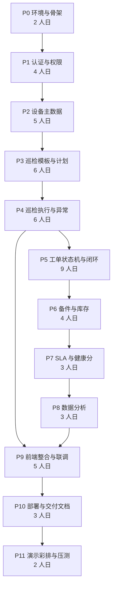

# 巡维云 EquipCare 开发计划、验收标准与风险控制

| 项 | 内容 |
|---|---|
| 文档编号 | EC-PLAN-005 |
| 版本 | V1.0 |
| 对应任务 | **J（开发阶段与依赖）、K（核心功能验收标准）、L（风险清单与解决方案）** |

---

## 1. 开发阶段与依赖关系（J）

### 1.1 前提假设

| 项 | 假设 |
|---|---|
| 开发人力 | 1 人（全栈），每日有效编码 6 小时 |
| 环境 | 本地 Windows + WSL/Git Bash + Docker Desktop；服务器 2C4G Linux |
| 技术熟练度 | 熟悉 Spring Boot 与 Vue 3，无需额外学习成本 |
| 交付周期 | 10 周（50 个工作日），含 20% 缓冲 |
| 评审节点 | 每阶段结束有可运行的"垂直切片"，禁止长期不联调 |

### 1.2 阶段划分

> 说明：P9 前端整合虽在图上排在 P8 之后，实际**每个阶段都伴随对应页面的开发与联调**（见各阶段交付物），P9 只做统一收口、样式统一与端到端回归，避免"最后集中联调"这一典型失控点。

### 1.3 各阶段详细计划

#### P0 环境与骨架（2 人日）

| 项 | 内容 |
|---|---|
| 依赖 | 无 |
| 任务 | ① 建 Git 仓库与分支规范（main/dev/feature）② 后端工程初始化（Maven、依赖锁定、多环境 yml）③ 前端 Vite 工程初始化（TS、Element Plus、路由、Pinia、Axios 封装）④ docker-compose 起 MySQL/Redis ⑤ 建库脚本框架与 Flyway（或手动 SQL 版本目录）⑥ 统一响应、异常、日志、traceId |
| 交付物 | 可启动的空壳前后端；`/api/health` 返回正常；数据库连接成功 |
| 出口标准 | `docker compose up -d` 后本地 `npm run dev` 能登录页打开并调通一个 ping 接口 |

#### P1 认证与权限（4 人日）

| 项 | 内容 |
|---|---|
| 依赖 | P0 |
| 任务 | ① 用户/角色/权限/部门表与初始化数据 ② 登录、JWT 签发解析、Redis 黑名单 ③ Spring Security 过滤链与 `@PreAuthorize` ④ 动态菜单接口 ⑤ 数据权限拦截器 ⑥ 前端登录页、主布局、动态路由、`v-permission` ⑦ 用户/角色管理页面 |
| 交付物 | 6 个角色可登录，菜单与按钮按权限差异显示；越权接口返回 403 |
| 出口标准 | 用 `inspect01` 账号调派单接口返回 403；用 `equip01` 调通；改角色权限后刷新立即生效 |
| 风险点 | 动态路由刷新丢失 → 路由守卫中 `next({...to, replace:true})` 重进 |

#### P2 设备主数据（5 人日）

| 项 | 内容 |
|---|---|
| 依赖 | P1 |
| 任务 | ① 类别树、位置树 CRUD ② 设备 CRUD + 资产编号生成 + 二维码 token ③ 二维码 PNG 生成与批量打包 ④ 扫码查询接口 ⑤ Excel 导入导出（EasyExcel）⑥ 设备列表/详情/编辑页面 ⑦ 设备详情多 Tab 骨架 |
| 交付物 | 24 台示例设备可增删改查；二维码可下载并用手机扫出档案页 |
| 出口标准 | 删除有在途工单的设备被拒绝并返回单号；导入 100 行含 3 行错误时返回逐行错误明细 |

#### P3 巡检模板与计划（6 人日）

| 项 | 内容 |
|---|---|
| 依赖 | P2 |
| 任务 | ① 模板与巡检项 CRUD、发布、版本升级 ② 四种巡检项类型的动态表单渲染 ③ 计划 CRUD、作用域展开、周期配置解析 ④ `next_generate_time` 计算 ⑤ 模板编辑页（含巡检项拖拽排序）与计划编辑页 |
| 交付物 | 3 套模板可发布；3 条计划可启用并正确算出下次生成时间 |
| 出口标准 | 已发布模板编辑被拒；新建版本后旧版本置 DISABLED 且历史任务仍引用旧版本 |

#### P4 巡检执行与异常（6 人日）

| 项 | 内容 |
|---|---|
| 依赖 | P3 |
| 任务 | ① 任务生成服务 + 定时任务 + 锁表 ② 我的任务列表与执行页（移动端优先）③ 草稿保存（Redis）④ 提交事务：校验 + 落库 + 服务端复算异常 ⑤ 异常记录与异常池页面 ⑥ 同项历史值对比 |
| 交付物 | 定时任务能生成当天任务；巡检员可完成一次含异常的巡检并留下异常记录 |
| 出口标准 | 提交时数值越界即使前端未勾选也被判异常；同一任务重复提交不产生重复异常 |

#### P5 工单状态机与闭环（9 人日，核心）

| 项 | 内容 |
|---|---|
| 依赖 | P4 |
| 任务 | ① 工单表、状态枚举、动作枚举 ② 状态机实现 + 转移表 + 守卫 + 副作用 ③ 状态机单元测试（84 种组合全覆盖）④ 派单池、派单/转派/撤回/接单/拒接 ⑤ 维修记录、挂起恢复、提交验收 ⑥ 验收通过/驳回 ⑦ 异常自动转单编排（含合并规则）⑧ 工单列表/详情/时间轴页面 |
| 交付物 | 从"巡检异常"到"验收通过"全链路可跑通；状态时间轴完整 |
| 出口标准 | 14 条非法转移全部返回 409 且状态不变；自验收被 403 拦截；并发两人接单只有一人成功 |
| 风险点 | 状态机与业务逻辑耦合过深 → 副作用抽成 `WorkOrderTransitionHandler` 策略，按动作分发 |

#### P6 备件与库存（4 人日）

| 项 | 内容 |
|---|---|
| 依赖 | P5（工单备件挂在工单上） |
| 任务 | ① 备件档案 CRUD ② 库存流水与出入库 ③ 工单备件申请/审批/出库/退料 ④ 低库存预警 ⑤ 备件与流水页面 |
| 交付物 | 维修中领用 2 个备件，库存正确扣减，流水前后快照连续 |
| 出口标准 | 50 并发领用同一备件，库存不为负，失败请求给出准确可用量 |

#### P7 SLA 与健康分（3 人日）

| 项 | 内容 |
|---|---|
| 依赖 | P5、P6 |
| 任务 | ① SLA 政策配置与时限计算 ② 每分钟扫描任务、预警与升级消息 ③ 挂起暂停计时逻辑 ④ 健康分计算与快照 ⑤ SLA 监控页、健康分组件 |
| 交付物 | 构造一张超时工单，1 分钟内被标记 OVERDUE 并产生 3 条消息 |
| 出口标准 | 挂起 2 小时后 `resolve_due_time` 顺延 120 分钟；健康分扣分项与快照字段一致 |

#### P8 数据分析（3 人日）

| 项 | 内容 |
|---|---|
| 依赖 | P5–P7 |
| 任务 | ① 8 个统计接口（全部 SQL 聚合）② ECharts 封装与 6 张图 ③ 仪表盘按角色差异化 ④ 报表导出 |
| 交付物 | 4 个分析页面，图表数据随业务操作实时变化 |
| 出口标准 | 新增一张工单后刷新看板，待派单数 +1；空数据渲染空状态而非报错 |

#### P9 前端整合与联调（5 人日）

| 项 | 内容 |
|---|---|
| 依赖 | P1–P8 |
| 任务 | ① 全站样式与交互统一 ② 四态（加载/空/错误/成功）补全 ③ 表单校验与错误提示对齐后端 ④ 端到端回归（按 K 节验收清单逐条过）⑤ 移动端适配 ⑥ 浏览器兼容性检查 |
| 交付物 | 全功能可演示版本；验收清单逐条打勾 |
| 出口标准 | 无 console 报错；无写死数据；无空壳按钮 |

#### P10 部署与交付文档（3 人日）

| 项 | 内容 |
|---|---|
| 依赖 | P9 |
| 任务 | ① 前后端镜像构建（多阶段 Dockerfile）② compose 编排、数据卷、健康检查、`.env` ③ Nginx 配置 ④ 服务器部署与初始化 SQL 导入 ⑤ 部署文档、演示说明、AI 使用说明、提示词记录整理 |
| 交付物 | 服务器可通过公网 IP 访问；文档齐全 |
| 出口标准 | 在全新服务器上按文档操作，30 分钟内可完成部署 |

#### P11 演示彩排与压测（2 人日）

| 项 | 内容 |
|---|---|
| 依赖 | P10 |
| 任务 | ① 按演示动线完整彩排 3 次，计时 ② JMeter 50 并发压核心接口 ③ 故障演练（重启、断网、MySQL 挂掉）④ 演示数据复位脚本 |
| 交付物 | 演示脚本与备份数据 |
| 出口标准 | 演示 12 分钟内完成；重启后 2 分钟内恢复可访问 |

### 1.4 阶段依赖与关键路径

| 阶段 | 前置 | 是否关键路径 | 可并行项 |
|---|---|:--:|---|
| P0 | — | 是 | — |
| P1 | P0 | 是 | 前端布局可与后端并行 |
| P2 | P1 | 是 | 二维码模块可与导入导出并行 |
| P3 | P2 | 是 | 模板页与计划页可并行 |
| P4 | P3 | 是 | 任务列表与执行页可并行 |
| P5 | P4 | 是（最长） | 状态机单测与页面开发可并行 |
| P6 | P5 | 否（有 1 天浮动） | 备件档案可提前到 P3 后做 |
| P7 | P5、P6 | 否 | 健康分可与 SLA 并行 |
| P8 | P5–P7 | 否 | 各图表独立，可穿插 |
| P9 | 全部 | 是 | — |
| P10 | P9 | 是 | 文档可与部署并行 |
| P11 | P10 | 是 | — |

**总人日**：2+4+5+6+6+9+4+3+3+5+3+2 = **52 人日**，按每周 5 天计约 10.5 周，含缓冲按 11 周排期。

### 1.5 里程碑与自检门禁

| 里程碑 | 时点 | 门禁条件（不满足不进入下一阶段） |
|---|---|---|
| M1 骨架可跑 | 第 1 周末 | 前后端联通、数据库可用、登录成功 |
| M2 主数据可用 | 第 3 周末 | 设备、模板、计划三类数据可维护 |
| M3 巡检可执行 | 第 5 周末 | 定时生成任务、移动端可完成巡检、异常入库 |
| M4 闭环可演示 | 第 7 周末 | 异常→工单→派单→接单→维修→备件→验收全通 |
| M5 数据可看 | 第 9 周末 | 看板与报表数据真实联动 |
| M6 可交付 | 第 10 周末 | 服务器部署成功、文档齐全、演示通过 |

### 1.6 单人开发的工程纪律

| 纪律 | 具体做法 |
|---|---|
| 小步提交 | 每个功能一个 commit，信息格式 `feat(workorder): 派单接口与状态机联动` |
| 每日可运行 | 主干分支任何时点可启动，不留半成品过夜（用 feature 分支 + 开关） |
| 先接口后页面 | 每个页面先定 DTO 与接口，用 Swagger 调通再写 UI |
| 单测守核心 | 只对状态机、库存扣减、转单判定、健康分四处写单测，覆盖率要求 80%，其余不追求 |
| 不用 AI 生成整模块 | AI 用于生成样板代码（CRUD、DTO、页面骨架）与排查报错，核心状态机与事务边界手写并逐行理解，避免"生成得出、讲不清" |
| 每周一次全链路手测 | 周五下午按演示动线走一遍，问题记入清单 |

---

## 2. 核心功能验收标准（K）

验收采用「前置条件 → 操作 → 预期结果」三段式，每条均可当场复现。全部通过视为功能验收合格。

### 2.1 认证与权限（AC-01）

| 编号 | 前置 | 操作 | 预期结果 |
|---|---|---|---|
| AC-01-1 | 系统有 admin 与 inspect01 账号 | 错误密码登录 5 次 | 第 6 次返回"账号已锁定，请 10 分钟后重试"，Redis 有计数键 |
| AC-01-2 | 已登录 inspect01 | 直接请求 `POST /api/workorders/1/dispatch` | 返回 403，`code=FORBIDDEN`，审计日志记录该次拒绝 |
| AC-01-3 | admin 修改 inspect01 角色权限 | inspect01 不重新登录，刷新页面 | 菜单与按钮立即变化（权限缓存已失效） |
| AC-01-4 | 已登录 | 修改 URL 直接访问 `/system/user` | 跳转 403 页，不渲染页面内容 |
| AC-01-5 | 用户被管理员禁用 | 该用户下一次请求接口 | 返回 401，前端跳登录页 |

### 2.2 设备资产（AC-02）

| 编号 | 前置 | 操作 | 预期结果 |
|---|---|---|---|
| AC-02-1 | — | 新增设备，不填资产编号 | 保存成功，编号为 `EQ-{类别码}-000001` 格式，服务端生成 |
| AC-02-2 | 已存在资产编号 | 导入 Excel 含重复编号 | 该行失败，返回"资产编号已存在"，其余行成功 |
| AC-02-3 | 设备存在 `IN_PROGRESS` 工单 | 删除该设备 | 返回 409，提示"存在未完结工单 WO20261030001" |
| AC-02-4 | 设备已生成二维码 | 手机扫码 | 打开 H5 档案页，展示名称、位置全路径、状态、健康分、最近 3 条工单 |
| AC-02-5 | 二维码已轮换 | 用旧码扫码 | 提示"二维码已失效，请联系设备管理员" |
| AC-02-6 | 两台终端同时编辑同一设备 | 先后保存 | 后者提示"数据已被他人修改，请刷新"，版本号不同步不覆盖 |

### 2.3 巡检模板与计划（AC-03）

| 编号 | 前置 | 操作 | 预期结果 |
|---|---|---|---|
| AC-03-1 | 模板为 DRAFT，0 个巡检项 | 点击发布 | 拒绝，提示"至少需要 1 个巡检项" |
| AC-03-2 | 模板已 PUBLISHED | 编辑模板名称 | 返回 423，提示需新建版本 |
| AC-03-3 | 已发布模板 | 新建版本 | 新模板 version=2 且为 DRAFT，旧版本 DISABLED，历史任务 `template_id` 仍指向旧版本 |
| AC-03-4 | 计划作用域选"不存在的类别" | 启用计划 | 保存成功但状态保持 DISABLED，提示"作用域下无可用设备" |
| AC-03-5 | 计划周期为每周一三五 09:00 | 启用 | `next_generate_time` 为下一个符合条件的时间，误差 0 |

### 2.4 巡检执行（AC-04）

| 编号 | 前置 | 操作 | 预期结果 |
|---|---|---|---|
| AC-04-1 | 计划已启用 | 触发"立即生成"，再触发一次 | 第一次生成 N 条任务；第二次生成 0 条（唯一键幂等），日志显示跳过 N 条 |
| AC-04-2 | 任务含必填项未填 | 提交 | 422，错误信息定位到具体巡检项名称 |
| AC-04-3 | 数值项范围 0–100 | 前端篡改为 150 提交（绕过前端校验） | 服务端判定 `is_abnormal=1`，任务结果 ABNORMAL |
| AC-04-4 | 有异常项但未上传照片 | 提交 | 422，提示"异常项必须上传现场照片" |
| AC-04-5 | 巡检中途关闭浏览器 | 重新进入任务 | 草稿恢复，已填内容不丢失 |
| AC-04-6 | 非任务执行人 | 提交该任务 | 403 |
| AC-04-7 | 任务 `sla_due_time` 已过 | 开始执行 | 允许执行，`overdue_flag=1`，列表显示"已逾期"标签 |

### 2.5 异常自动转工单（AC-05，重点）

| 编号 | 前置 | 操作 | 预期结果 |
|---|---|---|---|
| AC-05-1 | 巡检项 `auto_work_order=1` | 该项判为异常并提交任务 | 自动生成工单，`source=ANOMALY`，状态 `PENDING_DISPATCH`，异常状态 `CONVERTED` 且回填 `work_order_id` |
| AC-05-2 | 巡检项 `auto_work_order=0` 且等级 MEDIUM | 提交异常 | 不生成工单，异常状态 `OPEN`，进入异常池 |
| AC-05-3 | 同设备同项 24h 内第 2 次异常 | 提交 | 等级自动提升为 HIGH 并生成工单 |
| AC-05-4 | 设备已有 `IN_PROGRESS` 工单且故障类型相同 | 提交新异常 | 不新建工单，异常挂到已有工单，工单状态不变，维修人收到消息 |
| AC-05-5 | 设备已有工单但故障类型不同 | 提交新异常 | 新建第二张工单，两张工单并存，设备状态仍 REPAIRING |
| AC-05-6 | 转单过程中数据库异常（人为制造） | 提交任务 | 任务提交整体回滚，任务保持 IN_PROGRESS，异常与工单均未落库 |
| AC-05-7 | 网络重试同一提交请求 | 重复调用 submit | 只有一张工单，`anomaly_id` 唯一索引生效 |
| AC-05-8 | 转单成功 | 查看设备状态 | 设备由 `IN_USE` 变为 `REPAIRING` |

### 2.6 工单状态机（AC-06，重点）

| 编号 | 前置 | 操作 | 预期结果 |
|---|---|---|---|
| AC-06-1 | 工单 `PENDING_DISPATCH` | 调 `/accept` | 409 `WO_ILLEGAL_TRANSITION`，返回当前状态与允许动作 |
| AC-06-2 | 工单 `PENDING_DISPATCH` | `equip01` 派单给 repair01 | 状态 `PENDING_ACCEPT`，`assignee_id` 正确，写派单日志与状态日志 |
| AC-06-3 | 已派单 | 维修人 B 调 `/accept`（非 assignee） | 403 |
| AC-06-4 | 已派单 | 维修人 A 接单 | 状态 `IN_PROGRESS`，`accept_time` 写入 |
| AC-06-5 | 两台设备并发接同一工单 | 同时调 `/accept` | 仅一次成功，另一次返回 409 `WO_STATE_CHANGED` |
| AC-06-6 | 工单 `IN_PROGRESS` | 挂起（原因"等待备件"） | 状态 `SUSPENDED`，`sla_status=PAUSED` |
| AC-06-7 | 挂起 30 分钟后恢复 | 调 `/resume` | `suspend_total_minutes=30`，`resolve_due_time` 顺延 30 分钟 |
| AC-06-8 | 无 FINISH 记录 | 提交验收 | 422，提示"至少需要一条完工记录" |
| AC-06-9 | 有 APPLIED 状态备件 | 提交验收 | 422，提示"存在未出库的备件申请" |
| AC-06-10 | 维修人 A 自己验收 | 调 `/verify` | 403 `WO_SELF_VERIFY_FORBIDDEN` |
| AC-06-11 | 验收通过 | 查看设备与工单 | 工单 `COMPLETED`，`actual_finish_time` 与 `close_time` 写入，设备回 `IN_USE` |
| AC-06-12 | 验收驳回 | 查看工单 | 状态回 `IN_PROGRESS`，`reject_count+1`，`resolve_due_time` 未变（SLA 不重置） |
| AC-06-13 | 工单 `COMPLETED` | 尝试任何动作 | 全部 409，终态不可变更 |
| AC-06-14 | 工单 `PENDING_DISPATCH` | 取消（填原因） | 状态 `CANCELLED`，设备回滚到 `prev_equipment_status` |
| AC-06-15 | 全流程完成 | 查看状态时间轴 | 每个节点有 from/to/action/操作人/耗时，与操作记录一一对应 |

### 2.7 备件与库存（AC-07，重点）

| 编号 | 前置 | 操作 | 预期结果 |
|---|---|---|---|
| AC-07-1 | 备件库存 10 | 申请 3 个并出库 | 库存 7，流水一条 `OUT`，`before=10 after=7` |
| AC-07-2 | 备件库存 2 | 申请 5 个并出库 | 422 `STOCK_INSUFFICIENT`，提示"当前可用 2"，库存不变，无流水 |
| AC-07-3 | 50 并发各出库 1 个，库存 10 | 压测 | 成功 10 次，失败 40 次均返回明确原因，库存为 0，不为负 |
| AC-07-4 | 出库后验收驳回并退料 | 退料 | 库存回增，流水一条 `RETURN`，工单备件状态 `RETURNED` |
| AC-07-5 | 任意时点 | 反推库存 | 最后一条流水的 `after_stock` = 备件表 `current_stock` |
| AC-07-6 | 有流水的备件 | 删除 | 409，提示只能停用 |
| AC-07-7 | 库存等于安全库存 | 查询低库存清单 | 该备件在列，仪表盘预警数 +1 |

### 2.8 SLA（AC-08）

| 编号 | 前置 | 操作 | 预期结果 |
|---|---|---|---|
| AC-08-1 | 新建 P1 工单 | 查看工单 | `response_due_time = 创建时间 + 30min`，`resolve_due_time = +240min` |
| AC-08-2 | 工单剩余 20% 时间 | 等待扫描 | `sla_status=WARN`，维修人与派单人各收到 1 条预警消息（同一单不重复发） |
| AC-08-3 | 工单超时 | 等待扫描 | `sla_status=OVERDUE`，`overdue_flag=1`，维修人+派单人+MANAGER 均收到消息 |
| AC-08-4 | 工单已超时 | 查看工单状态 | 业务状态未被系统修改，仍为原状态 |
| AC-08-5 | 修改 P1 政策时限 | 查看在途工单 | 在途工单 `resolve_due_time` 不变，仅新工单生效 |

### 2.9 健康分（AC-09）

| 编号 | 前置 | 操作 | 预期结果 |
|---|---|---|---|
| AC-09-1 | 新增设备无任何业务数据 | 查看健康分 | 100 分，等级 HEALTHY |
| AC-09-2 | 设备近 90 天有 1 张 P1 工单（已完结） | 重算 | 得分 85，扣分明细中 `fault_score=15` |
| AC-09-3 | 设备有 2 张超时工单 | 重算 | `timeout_score=6` |
| AC-09-4 | 伪造数据使扣分总和 > 100 | 重算 | 分数为 0（不为负），等级 DANGER |
| AC-09-5 | 每日 02:00 | 查看快照表 | 当日每个设备一条快照，`stat_date` 唯一 |
| AC-09-6 | 工单验收通过 | 10 秒内刷新设备页 | 健康分已变化（增量重算生效，无需等次日） |

### 2.10 数据分析（AC-10）

| 编号 | 前置 | 操作 | 预期结果 |
|---|---|---|---|
| AC-10-1 | 记录当前待派单数 | 新建一张工单后刷新看板 | 数字 +1，与列表 count 一致 |
| AC-10-2 | 数据库无任何工单 | 打开分析页 | 图表显示"暂无数据"，不报错、不显示假曲线 |
| AC-10-3 | 查询跨度 400 天 | 调趋势接口 | 400，提示"查询跨度不能超过 365 天" |
| AC-10-4 | inspect01 登录 | 访问 `/analytics/overview` | 403（无该权限码） |
| AC-10-5 | manager01 登录 | 访问任意写接口 | 403 |
| AC-10-6 | 导出报表 | 点击导出 | 下载真实数据的 xlsx，行数与列表总数一致 |

### 2.11 非功能验收（AC-11）

| 编号 | 项 | 标准 | 验证方式 |
|---|---|---|---|
| AC-11-1 | 接口响应 | 列表接口 P95 ≤ 500ms（10 万工单） | JMeter 或日志统计 |
| AC-11-2 | 并发 | 50 并发下单/接单/出库无数据错乱 | JMeter 脚本 |
| AC-11-3 | 页面四态 | 每个列表页具备加载/空/错误/成功状态 | 人工逐页检查，断网模拟错误态 |
| AC-11-4 | 无假数据 | 全站搜索 `mock`、`Math.random`、固定数组 | 代码审查 + grep |
| AC-11-5 | 无空壳按钮 | 所有按钮均触发真实请求或明确提示 | 人工逐按钮点击 |
| AC-11-6 | 参数校验 | 所有写接口有 `@Valid` 或 Service 校验 | 代码审查 |
| AC-11-7 | 事务完整性 | 提交巡检失败时无脏数据 | 制造异常后查库 |
| AC-11-8 | 冷启动 | 服务器重启后 2 分钟内可访问 | 重启演练 |
| AC-11-9 | 演示时长 | 完整动线 ≤ 12 分钟 | 秒表计时 |
| AC-11-10 | 无 AI 依赖 | 删除所有 AI 配置后全功能可用 | 清空配置后回归 |

### 2.12 现场演示动线（12 分钟脚本）

| 时间 | 环节 | 演示要点 | 对应验收 |
|---|---|---|---|
| 0:00–1:00 | 登录与角色切换 | 用 inspect01 登录，菜单只有 5 项；切 equip01 菜单变 15 项 | AC-01-3 |
| 1:00–2:30 | 设备台账与扫码 | 列表筛选、打开详情看健康分趋势；手机扫码打开档案页 | AC-02-4 |
| 2:30–4:30 | 移动端巡检 | 开始任务、填数值（故意填越界）、拍照、提交 | AC-04-3 |
| 4:30–5:30 | 异常自动转单 | 切 equip01，工单池已出现新工单，展示来源异常与设备状态变 REPAIRING | AC-05-1、AC-05-8 |
| 5:30–6:30 | 派单 | 派单池展示维修人负载，派给 repair01 | AC-06-2 |
| 6:30–7:30 | 接单与维修 | 切 repair01 接单，写诊断记录，申请 2 个备件 | AC-06-4、AC-07-1 |
| 7:30–8:30 | 备件出库 | 切 equip01 审批出库，库存从 10 变 8，流水可查 | AC-07-1、AC-07-5 |
| 8:30–9:30 | 提交验收 | 完工记录 + 照片，提交验收 | AC-06-8 |
| 9:30–10:30 | 验收与自验收拦截 | 先用 repair01 尝试验收被 403；再切 verify01 通过 | AC-06-10、AC-06-11 |
| 10:30–11:30 | 数据看板 | 刷新看板：待派单 -1、已完成 +1、健康分变化、SLA 达成率 | AC-10-1、AC-09-6 |
| 11:30–12:00 | 异常路径 | 展示非法状态流转返回 409 的接口响应（Swagger） | AC-06-1 |

---

## 3. 风险清单与解决方案（L）

| # | 风险 | 概率 | 影响 | 触发信号 | 应对方案 |
|---|---|:--:|:--:|---|---|
| R1 | 状态机被绕过，出现"直接改库"式实现 | 中 | 高（评审致命） | 代码中出现多处 `setStatus` | ① 状态字段在实体上设为 `private` 且无 setter，仅状态机通过专用方法更新 ② CI 加 grep 检查 ③ 状态日志表与状态强一致校验（启动时扫描不一致数据告警） |
| R2 | 巡检提交事务过大导致锁等待 | 中 | 中 | 提交接口偶发 3s 以上 | ① 事务内只做写库，消息与健康分移到 `afterCommit` ② 任务项批量插入（`saveBatch`，500 条一批）③ 慢 SQL 日志阈值 500ms |
| R3 | 定时任务重复执行产生重复任务 | 中 | 中 | 任务数翻倍 | ① `sys_job_lock` 行锁 ② `(plan_id, equipment_id, plan_date)` 唯一索引 ③ 执行日志对比应生成数 vs 实际数 |
| R4 | 并发领用导致库存为负 | 中 | 高 | 库存出现负数 | ① 原子扣减 SQL + `CHECK` 约束双保险 ② 单元测试模拟 50 并发 ③ 库存巡检脚本每日对账（流水累计 vs 当前库存） |
| R5 | 演示当天服务器或网络故障 | 中 | 高 | 现场无法访问 | ① 本地 Docker 全量备份一份可随时切换 ② 演示数据 SQL 快照 ③ 提前录屏 3 分钟关键链路作为兜底 ④ 服务器安全组与端口提前 24h 验证 |
| R6 | 图片上传占满磁盘 | 中 | 中 | 磁盘使用率 > 80% | ① 单文件 10MB + 每单最多 5 张限制 ② 按日期分目录便于清理 ③ 磁盘监控与告警 ④ 压缩后存储（前端压缩到 1MB 内） |
| R7 | 数据权限漏洞导致越权查看 | 中 | 高 | 巡检员能看他人任务 | ① 拦截器统一注入 + 单测覆盖每种角色的 SQL ② 详情接口二次校验归属 ③ 抽查 6 个角色各 3 个接口 |
| R8 | 前端页面多、最后联调失控 | 高 | 高 | 到 P9 仍有页面无接口 | ① 每阶段完成对应页面（垂直切片）② 里程碑门禁卡住 ③ 页面清单打勾制 |
| R9 | 单人开发的"知识孤岛"，现场答不出实现细节 | 中 | 中 | 被问"为什么这样设计"答不上 | ① 本文档即为答辩底稿 ② 关键代码手写并写注释 ③ AI 生成代码必须能逐行解释，不接受黑盒 |
| R10 | 依赖版本冲突（Boot 3 + MyBatis-Plus + Springdoc） | 中 | 中 | 启动报 `NoSuchMethodError` | ① P0 阶段锁定版本并写进 `pom` 的 `dependencyManagement` ② 使用 Spring Boot BOM 管理 ③ 记录已验证的版本组合在部署文档 |
| R11 | MySQL 时区/字符集导致时间与中文异常 | 中 | 中 | 时间差 8 小时、表情符号乱码 | ① 容器 `TZ=Asia/Shanghai` + JDBC `serverTimezone=Asia/Shanghai` ② 全库 `utf8mb4` ③ 启动时自检脚本校验 |
| R12 | 演示数据被改乱，无法复现 | 高 | 中 | 彩排后数据状态不一致 | ① `demo-reset.sql` 一键复位 ② 复位走业务服务而非裸 insert ③ 演示前 30 分钟执行复位并走查一遍 |
| R13 | 接口数量多，文档与实现脱节 | 中 | 中 | Swagger 与实际不符 | ① 以 Swagger 注解为准，随代码更新 ② 交付前用脚本比对路由与文档 ③ 关键接口写集成测试 |
| R14 | 健康分/SLA 算法被质疑"拍脑袋" | 中 | 中 | 评审追问依据 | ① 公式公开在 PRD 与页面说明气泡 ② 快照表存 5 个扣分项，可当场拆解 ③ 参数做成可配置（权重表），说明可调 |
| R15 | 交付文档临时拼凑，质量低 | 中 | 高 | 文档与实际不符 | ① 文档随开发同步写（本文档为起点）② 部署文档由第二人（或自己换机）按文档实操验证 |

### 3.1 风险应对的优先级

| 优先级 | 风险 | 处理时点 |
|---|---|---|
| P0（开工即处理） | R1、R4、R10、R11 | P0–P1 阶段 |
| P1（阶段内处理） | R2、R3、R7、R8 | P4–P6 阶段 |
| P2（交付前处理） | R5、R6、R12、R13、R15 | P9–P11 阶段 |
| P3（持续） | R9、R14 | 全程 |

---

## 4. 交付物清单（对应任务要求 6、7）

### 4.1 代码与配置

| 类别 | 内容 | 位置 |
|---|---|---|
| 后端源码 | Spring Boot 工程全量 | `equipcare-server/` |
| 前端源码 | Vue 3 工程全量 | `equipcare-web/` |
| 数据库脚本 | 建表 `schema.sql`、初始化 `data.sql`、演示数据 `demo-data.sql` | `deploy/sql/` |
| 容器编排 | `docker-compose.yml`、`.env.example`、两个 `Dockerfile` | `deploy/` |
| Nginx 配置 | `nginx.conf`（静态 + 反代 + 上传） | `deploy/nginx/` |
| 运行脚本 | `start.sh`、`stop.sh`、`backup.sh`、`demo-reset.sh` | `deploy/scripts/` |
| 接口文档 | Swagger 在线 + 导出的 `openapi.json` | 运行时 / `docs/api/` |

### 4.2 文档

| 文档 | 对应任务 | 状态 |
|---|---|---|
| `01-PRD-产品需求文档.md` | A、B | 已完成 |
| `02-业务流程与状态机.md` | C | 已完成 |
| `03-技术架构与数据库设计.md` | D、E、F | 已完成 |
| `04-模块路由与接口规划.md` | G、H、I | 已完成 |
| `05-开发计划验收标准与风险.md` | J、K、L | 已完成 |
| `06-部署文档.md` | 任务 5、6 | 待开发阶段产出 |
| `07-演示说明.md` | 任务 6 | 待开发阶段产出（含 12 分钟脚本） |
| `08-AI辅助开发说明.md` | 任务 1、7 | 待开发阶段产出（见 4.3） |

### 4.3 AI 辅助开发过程记录（加分项）建议结构

| 章节 | 内容 | 证据形式 |
|---|---|---|
| 1 使用的 AI 平台与模型 | 平台名称、模型、使用起止时间、账号类型 | 截图 |
| 2 使用策略 | 哪些环节用 AI（样板代码、SQL、页面骨架、报错排查、文档润色），哪些不用（状态机、事务边界、权限校验） | 说明 + 比例统计 |
| 3 提示词记录 | 按阶段归档 20–30 条关键提示词，含"初始提示词 → 输出问题 → 追问修正 → 最终采纳"的完整链路 | 对话截图 + 文字记录 |
| 4 典型提示词模板 | 见下表 | 可直接复用 |
| 5 AI 输出的问题与人工修正 | 至少 5 个案例：AI 生成的代码哪里错了、为什么错、怎么改 | 代码 diff |
| 6 效果量化 | 各模块 AI 生成占比、节省工时估算、返工率 | 表格 |
| 7 结论与反思 | AI 适合与不适合的边界 | 300 字 |

**提示词模板（可直接用于记录）**

| 场景 | 提示词骨架 |
|---|---|
| 生成实体与 Mapper | "基于以下建表语句生成 MyBatis-Plus 实体类，要求：字段名驼峰映射、枚举字段用 `@EnumValue`、继承 BaseEntity、`@TableName` 指定表名、逻辑删除字段加 `@TableLogic`。建表语句：{DDL}" |
| 生成 CRUD 接口 | "为 {实体} 生成 Controller，要求：分页查询支持 {条件列表}、使用 `@PreAuthorize(\"hasAuthority('{权限码}')\")`、入参用 DTO 加 `@Valid`、返回 `Result<PageResult<VO>>`、方法上加 `@AuditLog(module, action)`。不要生成 Service 实现。" |
| 生成前端页面 | "用 Vue3 + TS + Element Plus 生成 {功能} 列表页，要求：使用 `useTable` 组合式函数、具备加载/空/错误/成功四态、搜索表单可重置、操作按钮用 `v-permission` 控制、分页参数 pageNum/pageSize、类型定义放 types 目录。" |
| 排查报错 | "以下报错信息与相关代码，请按可能性从高到低列出原因与验证方法，不要直接给完整重写方案：{报错 + 代码}" |
| SQL 优化 | "以下 SQL 在 10 万行数据下执行 3 秒，请分析执行计划可能的问题并给出索引建议，说明每个索引的选择理由与代价：{SQL + 表结构}" |

> 说明：AI 生成的内容必须经人工逐行审查后方可合入，尤其是涉及权限、事务、状态流转、库存扣减的代码。记录中如实体现"AI 出错并被修正"的过程，比只展示成功案例更有说服力。

### 4.4 提交前自检清单

| # | 检查项 | 通过 |
|---|---|:--:|
| 1 | 服务器公网可访问，演示账号可登录 | ☐ |
| 2 | 按 K 节 80 条验收标准逐条通过 | ☐ |
| 3 | 全站无 mock 数据、无写死统计、无空壳按钮 | ☐ |
| 4 | 数据库有真实业务数据，图表有曲线 | ☐ |
| 5 | Swagger 可访问且与实际接口一致 | ☐ |
| 6 | 部署文档在全新环境验证通过 | ☐ |
| 7 | 演示脚本彩排 3 次，均 ≤ 12 分钟 | ☐ |
| 8 | 演示数据复位脚本可用 | ☐ |
| 9 | AI 使用记录与提示词归档完整 | ☐ |
| 10 | 源码无密码明文、无本地绝对路径 | ☐ |
